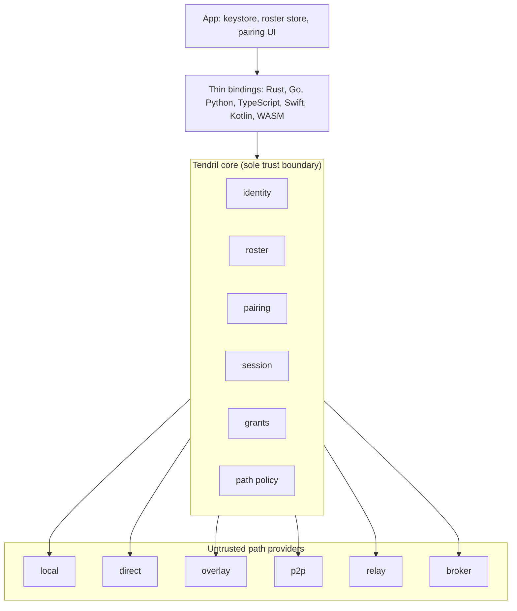

# Layers and boundaries

Tendril isolates security-critical logic inside one Rust core. Host applications provide storage and UI, language bindings translate types, and path providers move opaque bytes.

## Module responsibilities

| Module | Owns | Never owns |
|---|---|---|
| `identity` | Static and signing keypairs, device IDs, fingerprints, signed rotations | Platform keystore I/O, user accounts |
| `roster` | Known peers, device status (`pending`, `active`, `revoked`), grants, rotation chain | Network discovery, live presence inference |
| `pairing` | Pairing code proof, handshake binding, confirmation state, minting split | Socket dialing, UI rendering |
| `session` | Noise XXhfs handshake, length-prefixed framing, rekeying, close on fault | Path ranking, retries |
| `grants` | Capability grammar, signature verification, subset delegation, revocation lists | App authorization prompts |
| `path policy` | Provider registry, locality ranking, probing, fall-up triggers, rebuild on failure | Provider transport internals |

## Provider boundary

Providers carry sealed frames only. A provider may drop, delay, reorder, duplicate, or inject bytes, and it may misreport liveness. On any path failure, the core closes the bound session and rebuilds a fresh session on the next eligible provider rather than reusing a broken path.
