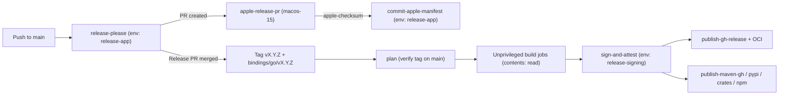

# CI, releases, and registry publishing

## Continuous integration (`.github/workflows/ci.yml`)

Every pull request and push to `main` runs the required `gate` check. On pull requests, the `changes` job invokes `scripts/ci-areas.sh` on `ubuntu-slim` to skip language lanes whose transitive inputs were not modified; pushes to `main`, `workflow_dispatch`, and changes to workflow definitions, `Makefile`, or `rust-toolchain.toml` run every lane:

| Job | Runner | Scope |
|---|---|---|
| `hygiene` | `ubuntu-24.04` | Pinned `okf` (`0.5.2`), `actionlint` (`1.7.12`), `pre-commit` hooks, and `zizmor` (`online-audits: false`) |
| `scripts` | `ubuntu-24.04` | Unit tests for `scripts/ci-areas.sh` and `scripts/prune_caches.py` |
| `rust` | `ubuntu-24.04` | `cargo fmt`, `clippy --all-targets --all-features -D warnings`, `tendril-ffi --no-default-features`, and `make test` |
| `vectors-go` | `ubuntu-24.04` | `make vectors/check bindings/go` (`github.com/agync/tendril/bindings/go`) |
| `bindings-python` | `ubuntu-24.04` | PyO3 `rustfmt`, `clippy`, and `make bindings/python` |
| `bindings-node` | `ubuntu-24.04` | N-API `rustfmt`, `clippy`, and `make bindings/node` |
| `bindings-web` | `ubuntu-24.04` | `wasm32-unknown-unknown`, pinned `wasm-bindgen` (`0.2.130`), headless Chrome E2E (`make bindings/web`) |
| `bindings-android` | `ubuntu-24.04` | NDK 27 + CMake 3.22.1, `make bindings/jni bindings/android`, Gradle `assembleDebugAndroidTest testDebugUnitTest lint` |
| `bindings-apple` | `macos-15` | Subpath `bindings/swift` `swift test`, root `Package.swift` remote `dump-package` (zero `unsafeFlags`, plus `release-please--*` PR version/checksum merge gate), root `TENDRIL_LOCAL_FFI=1 swift test`, and `scripts/build-xcframework.sh` + SwiftPM `CTendril` executable link smoke |
| `rust-platforms` | Linux ARM64, macOS 15, Windows | Cross-OS tests (`ubuntu-24.04-arm`, `macos-15` full workspace; `windows-2022` runs the `tendril-runtime` suite and tests platform-independent `tendril-core` and `tendril-relay`) |
| `site` | `ubuntu-24.04` | Strict `okf validate docs`, `make site PODMAN=/nonexistent`, and Playwright/axe `site/scripts/check.mjs` |
| `container` | `ubuntu-24.04` | Unsigned `buildah` build validation of root `Containerfile` |

`.github/actions/rust-toolchain` installs the toolchain pinned in `rust-toolchain.toml` (`1.97.1`) and strips extra preinstalled runner toolchains so `Swatinem/rust-cache` keys remain deterministic. `.github/workflows/cache-prune.yml` runs `scripts/prune_caches.py` on a 6-hourly schedule and `workflow_dispatch` to retain only the newest cache generation per job family on `main`.

## Automated releases (`release-please.yml` and `release.yml`)



1. **Release PRs and tags:** `.github/workflows/release-please.yml` uses the `agync` Release GitHub App (`RELEASE_APP_ID`, `RELEASE_APP_PRIVATE_KEY`) scoped to the `release-app` environment so release tags trigger `release.yml`. It synchronizes versions across `Cargo.toml`, internal workspace dependency specs, `bindings/python/{Cargo.toml,pyproject.toml}`, `bindings/node/{Cargo.toml,package.json}`, `bindings/web/package.json`, `bindings/kotlin/build.gradle.kts`, refreshes Cargo lockfiles on the release PR, and creates the Go submodule tag `bindings/go/vX.Y.Z`. When a release PR is opened or updated (`prs_created == 'true'`), an unprivileged `apple-release-pr` job (`macos-15`, `contents: read`) runs `scripts/build-xcframework.sh` to produce a deterministic `TendrilFFI.xcframework-<version>.zip`, verifies its SHA-256 via `swift package compute-checksum`, and uploads the `apple-checksum` artifact; `commit-apple-manifest` (`ubuntu-24.04`, `environment: release-app`) then validates the version and 64-hex checksum, updates `tendrilReleaseVersion` and `tendrilXCFrameworkChecksum` in root `Package.swift` on the PR branch, and commits using the Release App token before merge. To prevent merging a release PR with a stale version or the all-zero placeholder checksum, `ci.yml` always runs `bindings-apple` on `release-please--*` PRs and fails closed until `Package.swift` matches `.release-please-manifest.json` and carries a non-zero 64-hex `tendrilXCFrameworkChecksum` (which turns `gate` green after `commit-apple-manifest` triggers `synchronize`).
2. **Unprivileged builds (zero caches or secrets):** `build-binaries` (`linux-x86_64`, `linux-arm64`, `darwin-arm64`), `build-node` (`linux-x86_64`, `linux-arm64`, `darwin-arm64` N-API tarballs), `build-python-wheels` (ABI3 wheels; sdist deferred until crates.io publication), `build-web`, `build-android`, and `build-apple` run with `contents: read` and zero caches, signing keys, or registry credentials (Windows runtime/FFI/wheel release builds are still deferred, although `tendril-runtime` now builds and tests on Windows with the `local` provider backed by named pipes). `build-apple` calls `scripts/build-xcframework.sh` (building `aarch64-apple-darwin`, `aarch64-apple-ios`, and `aarch64-apple-ios-sim` with `--remap-path-prefix`, `-C debuginfo=0`, `ZERO_AR_DATE=1`, `strip -S`, `plutil -convert xml1`, and deterministic Python `zipfile` packing) and fails closed on tagged releases if the rebuilt archive SHA-256 differs from `tendrilXCFrameworkChecksum` in root `Package.swift`.
3. **Signing and provenance (`release-signing`):** `sign-and-attest` generates `SHA256SUMS` for every release asset first. When the repository is public and a release tag is present (`!github.event.repository.private`), it runs `actions/attest-build-provenance` over the built assets and `SHA256SUMS`, then attaches keyless Sigstore Cosign `.sigstore.json` bundles (`cosign sign-blob --yes --bundle`) so provenance attests only the build outputs and checksums rather than signature bundles. `publish-oci` pushes multi-arch `ghcr.io/agync/tendril-relay` manifests (`amd64` + `arm64`) and signs/attests the manifest digest when public.
4. **Package coordinates and publishing:**

| Ecosystem | Coordinate | Publish Trigger / Gate | Environment |
|---|---|---|---|
| crates.io | `tendril-{core,relay,runtime,cli,ffi,wasm}` | `vars.PUBLISH_CRATES == 'true'` + public repo | `crates-io` (OIDC) |
| PyPI | `tendril-sdk` (`import tendril`) | `vars.PUBLISH_PYPI == 'true'` + public repo | `pypi` (OIDC + PEP 740) |
| npm | `@tendril-sdk/web` | `vars.PUBLISH_NPM == 'true'` + public repo | `npm` (OIDC + provenance) |
| Node.js tarball | `tendril-node-<version>-<platform>.tar.gz` (`@tendril-sdk/node`) | `vX.Y.Z` tag (GitHub Release) | `release-app` / `release-signing` |
| Go | `github.com/agync/tendril/bindings/go` (links `tendril-ffi-<version>-<platform>.tar.gz`) | Submodule tag `bindings/go/vX.Y.Z` | `release-app` |
| Apple (SwiftPM) | Root `Package.swift` + `TendrilFFI.xcframework-<version>.zip` | Release PR updates `Package.swift`; `vX.Y.Z` tag attaches zip to GitHub Release | `release-app` / `release-signing` |
| Android Maven | `dev.agync:tendril-android` | `vars.PUBLISH_MAVEN_GH != 'false'` | Job `packages: write` (GH Packages) |
| OCI container | `ghcr.io/agync/tendril-relay` | `vX.Y.Z` tag | `release-signing` |

## Registry bootstrap for OIDC Trusted Publishing

- **PyPI (`tendril-sdk`):** PyPI supports Pending Publishers before the first upload. Create a Pending Publisher in PyPI account settings bound to owner `agync`, repo `tendril`, workflow `release.yml`, and environment `pypi` before the first release, then set repository variable `PUBLISH_PYPI=true`.
- **crates.io (`tendril-core` .. `tendril-wasm`):** crates.io requires each crate to exist before configuring Trusted Publishing. Leave `PUBLISH_CRATES` unset for `v0.1.0`, check out the `v0.1.0` tag after release creation, perform one manual `cargo publish --workspace --locked` with a short-lived scoped token, revoke that token, attach `agync/tendril` + `release.yml` + environment `crates-io` in crates.io settings for each of the 6 crates, and then set `PUBLISH_CRATES=true` for subsequent tags.
- **npm (`@tendril-sdk/web`):** npm requires the package to exist before configuring Trusted Publishing, and expires unused newly created Trusted Publisher configs after 48 hours. Leave `PUBLISH_NPM` unset for `v0.1.0`, download and Cosign-verify `tendril-sdk-web-0.1.0.tgz` from the `v0.1.0` release, run `npm publish tendril-sdk-web-0.1.0.tgz --access public`, then bind the Trusted Publisher (`agync/tendril`, `release.yml`, environment `npm`, without `registry-url` in `actions/setup-node` so no empty `_authToken` blocks OIDC) right before cutting the next release and set `PUBLISH_NPM=true`.
- **GHCR (`ghcr.io/agync/tendril-relay`):** Organization container packages default to Private; switch `tendril-relay` visibility to Public under organization package settings after the first tag push so unauthenticated pulls work.

## Verifying release signatures and provenance

```bash
# Verify a GitHub Release archive, wheel, AAR, or tarball against its Cosign v3 bundle
cosign verify-blob \
  --bundle tendril-0.1.0-linux-x86_64.tar.gz.sigstore.json \
  --certificate-identity-regexp '^https://github\.com/agync/tendril/\.github/workflows/release\.yml@refs/tags/v0\.1\.0$' \
  --certificate-oidc-issuer 'https://token.actions.githubusercontent.com' \
  tendril-0.1.0-linux-x86_64.tar.gz

# Verify GitHub SLSA build provenance for a release asset
gh attestation verify tendril-0.1.0-linux-x86_64.tar.gz --repo agync/tendril

# Verify the GHCR OCI manifest signature and SLSA attestation
cosign verify \
  --certificate-identity-regexp '^https://github\.com/agync/tendril/\.github/workflows/release\.yml@refs/tags/v0\.1\.0$' \
  --certificate-oidc-issuer 'https://token.actions.githubusercontent.com' \
  ghcr.io/agync/tendril-relay:v0.1.0

gh attestation verify oci://ghcr.io/agync/tendril-relay:v0.1.0 --owner agync
```

## Public website and docs (`tendril.agync.dev`)

Cloudflare Workers Builds deploys `site/dist` (landing pages, assets, `_headers`, and themed `docs/` rendered at `/docs/`) using `site/wrangler.jsonc`. CI validates the exact same `make site PODMAN=/nonexistent` build path (`site/toolchain.sh` verified against `site/okf-wiki.sha256`) and runs Playwright and axe accessibility checks in the `site` job. See [Website](website.md) for layout, build, and Cloudflare deployment settings.

## Repository lockdown and environment setup

Apply these repository settings with `gh api` (note that branch rulesets and public Cosign / Attestations require `agync/tendril` to be Public):

```bash
# 1. Restrict default token and forbid Actions PR approvals
gh api -X PUT repos/agync/tendril/actions/permissions/workflow \
  -f default_workflow_permissions=read -F can_approve_pull_request_reviews=false

# 2. Enforce selected actions + immutable SHA pinning
gh api -X PUT repos/agync/tendril/actions/permissions \
  -F enabled=true -f allowed_actions=selected -F sha_pinning_required=true

gh api -X PUT repos/agync/tendril/actions/permissions/selected-actions \
  -F github_owned_allowed=true -F verified_allowed=true \
  -f 'patterns_allowed[]=Swatinem/rust-cache@*' \
  -f 'patterns_allowed[]=googleapis/release-please-action@*' \
  -f 'patterns_allowed[]=sigstore/cosign-installer@*' \
  -f 'patterns_allowed[]=rust-lang/crates-io-auth-action@*' \
  -f 'patterns_allowed[]=pypa/gh-action-pypi-publish@*' \
  -f 'patterns_allowed[]=pyo3/maturin-action@*' \
  -f 'patterns_allowed[]=zizmorcore/zizmor-action@*' \
  -f 'patterns_allowed[]=gradle/actions/*' \
  -f 'patterns_allowed[]=redhat-actions/*'
```

Create separate GitHub Environments with strict branch/tag deployment policies:
- `release-app`: restrict to branch `main` and tags `v*.*.*`; store `RELEASE_APP_ID` and `RELEASE_APP_PRIVATE_KEY`.
- `release-signing`, `crates-io`, `pypi`, `npm`: restrict to tags `v*.*.*` (optionally add required reviewers on publishing environments).
