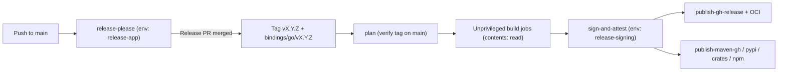

# CI, releases, and registry publishing

## Continuous integration (`.github/workflows/ci.yml`)

Every pull request and push to `main` runs the required `gate` check. On pull requests, the `changes` job invokes `scripts/ci-areas.sh` on `ubuntu-slim` to skip language lanes whose transitive inputs were not modified; pushes to `main`, `workflow_dispatch`, and changes to workflow definitions, `Makefile`, or `rust-toolchain.toml` run every lane:

| Job | Runner | Scope |
|---|---|---|
| `hygiene` | `ubuntu-24.04` | Pinned `okf` (`0.5.2`), `actionlint` (`1.7.12`), `pre-commit` hooks, and `zizmor` (`online-audits: false`) |
| `scripts` | `ubuntu-24.04` | Unit tests for `scripts/ci-areas.sh` and `scripts/prune_caches.py` |
| `rust` | `ubuntu-24.04` | `cargo fmt`, `clippy --all-targets --all-features -D warnings`, `tendril-ffi --no-default-features`, and `make test` |
| `vectors-go` | `ubuntu-24.04` | `make vectors/check bindings/go` (`github.com/agync/tendril/bindings/go`) |
| `bindings-python` | `ubuntu-24.04` | PyO3 `rustfmt`, `clippy`, and `make bindings/python` |
| `bindings-node` | `ubuntu-24.04` | N-API `rustfmt`, `clippy`, and `make bindings/node` |
| `bindings-web` | `ubuntu-24.04` | `wasm32-unknown-unknown`, pinned `wasm-bindgen` (`0.2.130`), headless Chrome E2E (`make bindings/web`) |
| `bindings-android` | `ubuntu-24.04` | NDK 27 + CMake 3.22.1, `make bindings/jni bindings/android`, Gradle `assembleDebugAndroidTest testDebugUnitTest lint` |
| `bindings-apple` | `macos-15` | `swift test` plus `aarch64-apple-darwin`, `aarch64-apple-ios`, and `aarch64-apple-ios-sim` FFI builds |
| `rust-platforms` | Linux ARM64, macOS 15, Windows | Cross-OS tests (`ubuntu-24.04-arm`, `macos-15` full workspace; `windows-2022` tests platform-independent `tendril-core` and `tendril-relay`) |
| `site` | `ubuntu-24.04` | Strict `okf validate docs`, `make site PODMAN=/nonexistent`, and Playwright/axe `site/scripts/check.mjs` |
| `container` | `ubuntu-24.04` | Unsigned `buildah` build validation of root `Containerfile` |

`.github/actions/rust-toolchain` installs the toolchain pinned in `rust-toolchain.toml` (`1.97.1`) and strips extra preinstalled runner toolchains so `Swatinem/rust-cache` keys remain deterministic. `.github/workflows/cache-prune.yml` runs `scripts/prune_caches.py` on a 6-hourly schedule and `workflow_dispatch` to retain only the newest cache generation per job family on `main`.

## Automated releases (`release-please.yml` and `release.yml`)



1. **Release PRs and tags:** `.github/workflows/release-please.yml` uses the `agync` Release GitHub App (`RELEASE_APP_ID`, `RELEASE_APP_PRIVATE_KEY`) scoped to the `release-app` environment so release tags trigger `release.yml`. It synchronizes versions across `Cargo.toml`, internal workspace dependency specs, `bindings/python/{Cargo.toml,pyproject.toml}`, `bindings/node/{Cargo.toml,package.json}`, `bindings/web/package.json`, `bindings/kotlin/build.gradle.kts`, refreshes Cargo lockfiles on the release PR, and creates the Go submodule tag `bindings/go/vX.Y.Z`.
2. **Unprivileged builds (zero caches or secrets):** `build-binaries` (`linux-x86_64`, `linux-arm64`, `darwin-arm64`), `build-python-wheels` (ABI3 wheels; sdist deferred until crates.io publication), `build-web`, `build-android`, and `build-apple` run with `contents: read` and zero caches, signing keys, or registry credentials (Windows runtime/FFI/wheel builds are deferred until `tendril-runtime` Unix-socket IPC is gated for Windows).
3. **Signing and provenance (`release-signing`):** `sign-and-attest` emits `SHA256SUMS` for every release asset. When the repository is public and a release tag is present (`!github.event.repository.private`), it attaches keyless Sigstore Cosign `.sigstore.json` bundles and SLSA build provenance (`actions/attest-build-provenance`). `publish-oci` pushes multi-arch `ghcr.io/agync/tendril-relay` manifests (`amd64` + `arm64`) and signs/attests the manifest digest when public.
4. **Package coordinates and publishing:**

| Ecosystem | Coordinate | Publish Trigger / Gate | Environment |
|---|---|---|---|
| crates.io | `tendril-{core,relay,runtime,cli,ffi,wasm}` | `vars.PUBLISH_CRATES == 'true'` + public repo | `crates-io` (OIDC) |
| PyPI | `tendril-sdk` (`import tendril`) | `vars.PUBLISH_PYPI == 'true'` + public repo | `pypi` (OIDC + PEP 740) |
| npm | `@tendril-sdk/web` | `vars.PUBLISH_NPM == 'true'` + public repo | `npm` (OIDC + provenance) |
| Go | `github.com/agync/tendril/bindings/go` | Submodule tag `bindings/go/vX.Y.Z` | `release-app` |
| Android Maven | `dev.agync:tendril-android` | `vars.PUBLISH_MAVEN_GH != 'false'` | Job `packages: write` (GH Packages) |
| OCI container | `ghcr.io/agync/tendril-relay` | `vX.Y.Z` tag | `release-signing` |

## Registry bootstrap for OIDC Trusted Publishing

- **PyPI (`tendril-sdk`):** Create a Pending Publisher in PyPI account settings bound to owner `agync`, repo `tendril`, workflow `release.yml`, environment `pypi` before the first release, then set repository variable `PUBLISH_PYPI=true`.
- **crates.io (`tendril-core` .. `tendril-wasm`):** crates.io requires each crate to exist before configuring Trusted Publishing. Perform one manual `cargo publish` bootstrap in topological order (`tendril-core`, `tendril-relay`, `tendril-runtime`, `tendril-cli`, `tendril-ffi`, `tendril-wasm`), attach `agync/tendril` + `release.yml` + environment `crates-io` in crates.io settings for each crate, then set `PUBLISH_CRATES=true`.
- **npm (`@tendril-sdk/web`):** Publish `@tendril-sdk/web` once manually with `--access public`, bind the Trusted Publisher (`agync/tendril`, `release.yml`, environment `npm`) in npmjs package settings, then set `PUBLISH_NPM=true`.

## Public website and docs (`tendril.agync.dev`)

Cloudflare Workers Builds deploys `site/dist` (landing pages, assets, `_headers`, and themed `docs/` rendered at `/docs/`) using `site/wrangler.jsonc`. CI validates the exact same `make site PODMAN=/nonexistent` build path (`site/toolchain.sh` verified against `site/okf-wiki.sha256`) and runs Playwright and axe accessibility checks in the `site` job. See [Website](website.md) for layout, build, and Cloudflare deployment settings.

## Repository lockdown and environment setup

Apply these repository settings with `gh api` (note that branch rulesets and public Cosign / Attestations require `agync/tendril` to be Public):

```bash
# 1. Restrict default token and forbid Actions PR approvals
gh api -X PUT repos/agync/tendril/actions/permissions/workflow \
  -f default_workflow_permissions=read -F can_approve_pull_request_reviews=false

# 2. Enforce selected actions + immutable SHA pinning
gh api -X PUT repos/agync/tendril/actions/permissions \
  -F enabled=true -f allowed_actions=selected -F sha_pinning_required=true

gh api -X PUT repos/agync/tendril/actions/permissions/selected-actions \
  -F github_owned_allowed=true -F verified_allowed=true \
  -f 'patterns_allowed[]=Swatinem/rust-cache@*' \
  -f 'patterns_allowed[]=googleapis/release-please-action@*' \
  -f 'patterns_allowed[]=sigstore/cosign-installer@*' \
  -f 'patterns_allowed[]=rust-lang/crates-io-auth-action@*' \
  -f 'patterns_allowed[]=pypa/gh-action-pypi-publish@*' \
  -f 'patterns_allowed[]=pyo3/maturin-action@*' \
  -f 'patterns_allowed[]=zizmorcore/zizmor-action@*' \
  -f 'patterns_allowed[]=gradle/actions/*' \
  -f 'patterns_allowed[]=redhat-actions/*'
```

Create separate GitHub Environments with strict branch/tag deployment policies:
- `release-app`: restrict to branch `main` and tags `v*.*.*`; store `RELEASE_APP_ID` and `RELEASE_APP_PRIVATE_KEY`.
- `release-signing`, `crates-io`, `pypi`, `npm`: restrict to tags `v*.*.*` (optionally add required reviewers on publishing environments).
