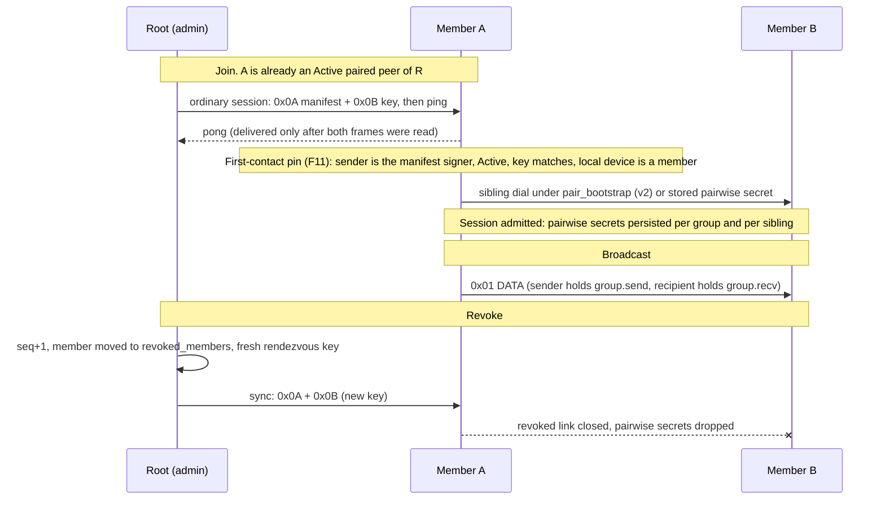

# Small peer mesh groups

A group links up to **32 devices** that each enrolled once with a group root. Every sibling link is an independent pairwise `Noise_XXhfs_25519+MLKEM768_ChaChaPoly_SHA256` session, so there is no shared group key and no group-wide ratchet. The group adds three things on top of pairwise links: a signed membership manifest, a rendezvous key for first contact between siblings, and gossip of newer manifests. Relays stay stateless and learn nothing about groups.

Normative rules live in `spec/groups-v1.md`. This page explains the design and links to it; it never replaces it.

## Model

| Concept | What it is |
|---|---|
| `group_id` | `"grp_" + hex_lower(SHA-256(root_signing_pub)[0..8])`, 20 ASCII characters. The founding root key is immutable, so a root identity roots exactly one group. |
| Manifest | Compact JSON `GroupManifest` signed with the hybrid `Ed25519 + ML-DSA-65` key over `"tendril-group-v1\0" \|\| JCS(manifest)`. Carries `seq`, `min_wire_version`, `ts`/`expires_at`, members, and permanent `revoked_members`. |
| Root and co-admin | The founding root can always sign. Up to 8 co-admins sign through an `admin_grant` capability bound to their own signing key (`group.admin:<group_id>/<sha256 of signer key>`), so a lifted public grant cannot be reused with another key. |
| Member | `device_id`, pinned `static_pub`, `signing_pub_hash`, `relay_pub`, endpoint hints, and up to 16 capabilities. |
| Capabilities | Every `member.caps` resource must be `group_id` or start with `group_id/`. `group.send:<group_id>` and `group.recv:<group_id>` gate application data. `group.admin` never appears in `member.caps`. |
| Rendezvous key | A 32-byte key delivered in frame `0x0B`. It derives the first-contact `pair_bootstrap` between two siblings and rotates on every removal. |

Siblings are group scoped. They never enter the endpoint's persisted trust roster, so a sibling cannot open an ordinary session or receive a grant without explicit pairing (see [Capability grants](grants.md)).

## Join, broadcast, revoke

## Trust model

| Rule | Behavior | Spec |
|---|---|---|
| First-contact pin (F11) | The first ingest of an unknown group pins `root_signing_pub`. A runtime pins a manifest pushed over an ordinary session only when the authenticated sender is the manifest's `signer_device_id`, is an `Active` ordinarily paired peer, its pinned signing key equals the manifest signing key, and the local device is an active member. Gossip never creates a group. | R1 |
| Sequence rules | `seq > local_seq` and `seq - local_seq <= 1024`. Same `seq` with different bytes is a fork; lower is a rollback. Every later manifest carries the pinned root key and the byte-identical root entry when co-admin signed. | R1, R3 |
| Revocation | Removal implies permanent revocation, and `revoked_members` only grows (at most 256). A re-added revoked member is refused. | R4 |
| Rendezvous rotation | A fresh key is generated on creation and on every removal. A `0x0B` is accepted only from the root or a live co-admin, only for the stored `seq`, and after a revocation only with a rotated key. Adding a member keeps the key and re-binds it to the new `seq`. | R8 |
| CRL | The founding root's revocation list is read for every admin and sibling decision. Every stored revocation list signed by the founding root key applies (any label, union across lists); a later list from the root replaces the earlier one under its label. Once a member applies the root's verified key rotation, its groups fail closed and their links close, whether or not a re-signed list has arrived. An unconfirmed (`Pending`) host pin that merely carries the root `device_id` as its label counts as no entry: it never closes a group and never keeps a rotated local root's groups open. A CRL entry closes the matching links and refuses new ones. | Section 5.2, Section 8 |
| Wire floors per group | `min_wire_version` never decreases across `seq`. On a group with floor 2 both ends refuse Wire v1 sibling sessions, and a v2 session with padding disabled cannot carry group frames. Any session that is not a sibling session must meet the ordinary peer's persisted floor. | R7 |
| Expiry | `ts < expires_at <= ts + 90 days`; ingest allows `ts` at most 30 s ahead. An expired stored manifest stays stored and authorization against it fails closed. | R6 |

Authority is never cached. Admission is re-checked after pairwise persistence, a change to the stored manifest or the root CRL closes every link whose peer is no longer an active, CRL-clean member, and each `0x01`, `0x0A`, and `0x0B` write re-checks recipient authority under the session writer immediately before sealing.

## Wire shape

| Item | Detail |
|---|---|
| Frame `0x0A` `GROUP_MANIFEST` | Compact manifest JSON, at most 32768 bytes |
| Frame `0x0B` `GROUP_RENDEZVOUS` | `group_id (20 B) \|\| seq (8 B) \|\| key (32 B)`, exactly 60 bytes |
| `SessionHello.groups` | Optional gossip list of `{group_id, seq}`, at most 16, sent by the initiator only and limited to the group of the session it is dialing |
| Wire v2 bootstrap | A first sibling link is admitted under `pair_bootstrap` (HKDF over the rendezvous key, `seq`, and both device ids). After `Established` both ends overwrite their stored pairwise secret with the exported ones, so later dials use the pairwise secret and rotate only on revocation |

See [Wire protocol and pairing](wire-and-pairing.md) and [Wire v2 privacy profile](wire-v2-privacy.md) for the surrounding frame and handshake rules.

## Runtime shape

`tendril-core` is Sans-I/O: it never performs I/O and never ingests a frame on its own. `tendril-runtime` wires frames to the group book.

| Component | Role |
|---|---|
| `GroupPool` | One per local group. Dials siblings lazily from the stored manifest, reuses healthy sessions, and builds only in-memory, group-scoped rosters. |
| Bounded fan-out | `broadcast` dials missing siblings concurrently, at most 8 at once (`MAX_CONCURRENT_GROUP_DIALS`), each within a 5 s dial budget. A failing peer lands in `offline` or `failed` and never blocks the rest. A revocation cancels queued and in-flight writes to the revoked peer. |
| `GroupHub` | Inbound dispatcher on `tendril serve` and on the first `tendril_group_open` of an FFI endpoint. Python and Node `group_open` build a standalone pool with no hub, so they accept sibling sessions only on the pool's own `listen_addr`. After the handshake it installs a session in a pool only when the initiator advertises exactly one local group and the peer is an active pinned member; every other session must be an `Active` paired peer. |
| Book watcher | Each pool polls the group book and root CRL every 250 ms, so a manifest ingested over an ordinary session or written by another process applies promptly (membership events and the revocation sweep). |
| Admin sync | `sync` pushes `0x0A` and `0x0B` over a live sibling link, else over an ordinary paired session to the member (acknowledged by ping and pong), else by a sibling dial. |
| Ordinary sessions | A member is onboardable when its pool runs a listener (`listen_addr`), or when its host accepts and polls ordinary sessions: the runtime ingests group frames from them through `handle_session_group_frame`. A listener serves at most 4 admin control sessions (`MAX_ADMIN_SESSIONS`), each closing after 10 s without a control frame (`ADMIN_SESSION_IDLE_TIMEOUT`). A Python or Node member without `listen_addr` is still onboardable through an ordinary session it accepts and polls. The member answers the admin ping only while its host polls the session, so the host must keep polling until the session closes; the admin waits at most 10 s (or the dial or write budget when larger) for that answer. |
| Dialers | Pools dial siblings through direct, local, relay (with the endpoint's relay auth), overlay, and broker dialers. `tendril serve`, the `group sync` and `group broadcast` commands add a p2p dialer for `iroh://` endpoints only when p2p is configured: any `--p2p*` flag on the CLI. Python and Node `group_open` and the FFI group hub add a `P2pDialer` only when a p2p relay mode is configured explicitly (`p2p_relay_mode` or `p2p_relay_urls` through `configure_transports_json` or `configureTransportsJson`) or `TENDRIL_P2P_LOCAL=1` is set; Pkarr, private-address, advertise, and relay-auth settings alone never add one or select public relays. |
| Endpoint close | `GroupPool::close` returns only after every in-flight state store access of the pool finished, and the pool touches the state directory no more afterwards. In Python and Node, `Endpoint.close` also closes every group opened from it. In the FFI, `tendril_endpoint_close` shuts down the group hub. |
| Removed devices | A device removed from a group drops its rendezvous and pairwise secrets, keeps only the manifest for `seq` and fork checks, and refuses `0x0B`. |

Command-line use is covered in [CLI demo](../usage/cli-demo.md) and host-language surfaces in [FFI ABI and bindings](../reference/ffi-and-bindings.md).

## Bounds

| Constant | Value | Meaning |
|---|---|---|
| `MAX_GROUP_MEMBERS` | 32 | Active entries in `members` |
| `MAX_GROUP_CO_ADMINS` | 8 | Enforced by the builder API only |
| `MAX_LOCAL_GROUPS` | 16 | Groups an endpoint is an active member or root of; a further group is refused, never pinned. Removed groups do not count |
| `MAX_STORED_GROUPS` | 64 | Stored records of any role, including groups the endpoint was removed from |
| `MAX_GROUP_MANIFEST_LEN` | 32 KiB (32768 B) | Signed compact manifest; a realistic 32-member manifest is about 20 KiB |
| `MAX_GROUP_SEQ_JUMP` | 1024 | Largest `seq - local_seq` accepted for a known group |
| `MAX_MANIFEST_VALIDITY` | 90 days | Maximum `expires_at - ts` (the builder default is 30 days) |
| `MAX_REVOKED_MEMBERS` | 256 | Entries in `revoked_members` |
| `MAX_GOSSIP_GROUPS` | 16 | Entries in `SessionHello.groups` |
| `MAX_ADMIN_SESSIONS` | 4 | Concurrent ordinary admin control sessions per pool |
| `ADMIN_SESSION_IDLE_TIMEOUT` | 10 s | Idle limit of such a session |

## Known limitations

| Limit | Detail |
|---|---|
| Multipath divergence | When one initiator reaches the same sibling over two paths at once, the two ends can persist the exported secrets of different links. The next dial recovers through a single `pair_bootstrap` retry. Until the current-`seq` key is available to both ends, those siblings cannot reconnect. |
| No per-signer quota | A paired peer that signs manifests can fill the local group slots (`MAX_LOCAL_GROUPS`) with groups it roots. Slot limits are the only bound. |
| Relay sibling links | A `/v2/relay` endpoint in a manifest is not dialed and no group mailbox listener exists, so siblings cannot link over a mailbox relay. Use direct, local, overlay, broker, p2p, or `/v1/relay` endpoints. |
| Rotated host-labeled root | A root whose roster label differs from its `device_id` and that rotates keys stops supplying a root CRL to its groups. Only roots built on the core API directly can carry such a label; runtime roots use their `device_id` and fail closed on rotation. |
| Colliding host label | A non-`Pending` entry (`Active` or `Revoked`, including a never-confirmed pin later revoked locally) whose label equals a group root's `device_id` and whose keys have rotated closes that root's groups (fail closed), because a roster entry does not record where its key lineage started. A `Pending` pin there counts as no entry. A local root closes its own groups whenever the list under its own label does not verify under its key, so a confirmed peer that chose that label and stored a list of its own there cannot clear the root's revocations. |
| Python and Node inbound | Without a hub, a Python or Node endpoint receives sibling sessions only on a `group_open` `listen_addr`; there is no shared listener across its groups. |
| Browser | The browser is a member-side endpoint: it can ingest manifests, authorize peers, and broadcast over app-supplied sessions, but it cannot create or administer groups, run `sync`, or listen. |
| Sealed mobile endpoints | Kotlin `TendrilEndpoint.create` and Swift `init(stateDir:)` use sealed, store-less endpoints and cannot host groups yet; group APIs need a state-directory endpoint. |
| CI coverage | The Kotlin and Swift group sources are not verified on Linux CI. |
| Backward compatibility | Peers built before groups reject the unknown `SessionHello.groups` field (R9), acceptable before 1.0. |
