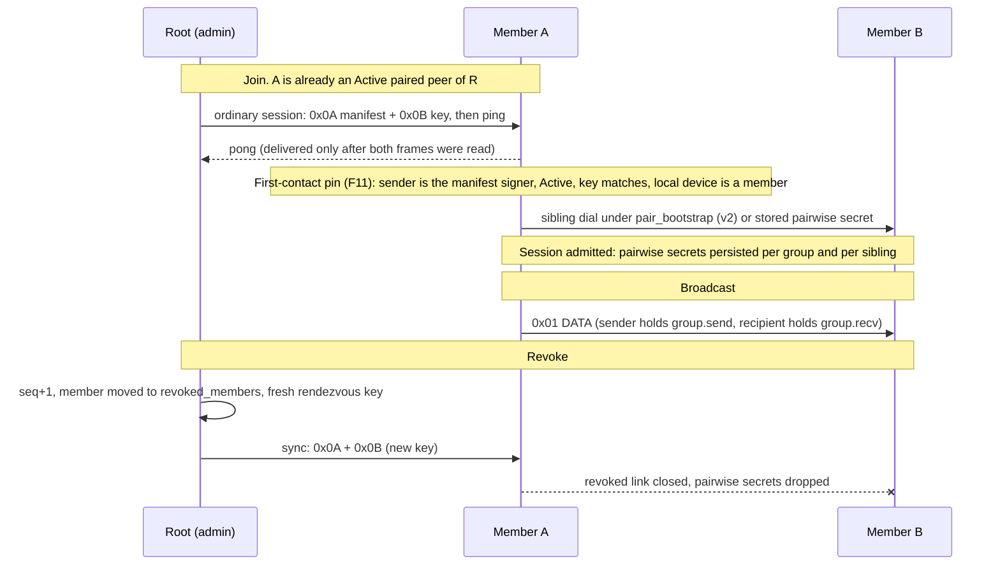

# Small peer mesh groups

A group links up to **32 devices** that each enrolled once with a group root. Every sibling link is an independent pairwise `Noise_XXhfs_25519+MLKEM768_ChaChaPoly_SHA256` session, so there is no shared group key and no group-wide ratchet. The group adds three things on top of pairwise links: a signed membership manifest, a rendezvous key for first contact between siblings, and gossip of newer manifests. Relays stay stateless and learn nothing about groups.

Normative rules live in `spec/groups-v1.md`. This page explains the design and links to it; it never replaces it.

## Model

| Concept | What it is |
|---|---|
| `group_id` | `"grp_" + hex_lower(SHA-256(root_signing_pub)[0..8])`, 20 ASCII characters. The founding root key is immutable, so a root identity roots exactly one group. |
| Manifest | Compact JSON `GroupManifest` signed with the hybrid `Ed25519 + ML-DSA-65` key over `"tendril-group-v1\0" \|\| JCS(manifest)`. Carries `seq`, `min_wire_version`, `ts`/`expires_at`, members, and permanent `revoked_members`. |
| Root and co-admin | The founding root can always sign. Up to 8 co-admins sign through an `admin_grant` capability bound to their own signing key (`group.admin:<group_id>/<sha256 of signer key>`), so a lifted public grant cannot be reused with another key. |
| Member | `device_id`, pinned `static_pub`, `signing_pub_hash`, `relay_pub`, endpoint hints, and up to 16 capabilities. |
| Capabilities | Every `member.caps` resource must be `group_id` or start with `group_id/`. `group.send:<group_id>` and `group.recv:<group_id>` gate application data. `group.admin` never appears in `member.caps`. |
| Rendezvous key | A 32-byte key delivered in frame `0x0B`. It derives the first-contact `pair_bootstrap` between two siblings and rotates on every removal. |

Siblings are group scoped. They never enter the endpoint's persisted trust roster, so a sibling cannot open an ordinary session or receive a grant without explicit pairing (see [Capability grants](grants.md)).

## Join, broadcast, revoke

## Trust model

| Rule | Behavior | Spec |
|---|---|---|
| First-contact pin (F11) | The first ingest of an unknown group pins `root_signing_pub`. A runtime pins a manifest pushed over an ordinary session only when the authenticated sender is the manifest's `signer_device_id`, is an `Active` ordinarily paired peer, its pinned signing key equals the manifest signing key, and the local device is an active member, with at most 4 stored groups per pinning peer. When reverse pairing left several roster entries for the sender, any revoked entry refuses the pin and otherwise one `Active` entry with that key suffices; `group_add_member` selects its entry the same way. Gossip never creates a group. | R1 |
| Sequence rules | `seq > local_seq` and `seq - local_seq <= 1024`. Same `seq` with different bytes is a fork; lower is a rollback. Every later manifest carries the pinned root key and the byte-identical root entry when co-admin signed. | R1, R3 |
| Revocation | Removal implies permanent revocation, and `revoked_members` only grows (at most 256). A re-added revoked member is refused. | R4 |
| Rendezvous rotation | A fresh key is generated on creation and on every removal. A `0x0B` is accepted only from the root or a live co-admin, only for the stored `seq`, and after a revocation only with a rotated key. Adding a member keeps the key and re-binds it to the new `seq`. | R8 |
| CRL | The founding root's revocation list is read for every admin and sibling decision. Every stored revocation list signed by the founding root key applies (any label, union across lists); a later list from the root replaces the earlier one under its label. Once a member applies the root's verified key rotation, its groups fail closed and their links close, whether or not a re-signed list has arrived. An unconfirmed (`Pending`) host pin that merely carries the root `device_id` as its label counts as no entry: it never closes a group and never keeps a rotated local root's groups open. A CRL entry closes the matching links and refuses new ones. | Section 5.2, Section 8 |
| Wire floors per group | `min_wire_version` never decreases across `seq`. On a group with floor 2 both ends refuse Wire v1 sibling sessions, and a v2 session with padding disabled cannot carry group frames. Any session that is not a sibling session must meet the ordinary peer's persisted floor. | R7 |
| Expiry | `ts < expires_at <= ts + 90 days`; ingest allows `ts` at most 30 s ahead. An expired stored manifest stays stored and authorization against it fails closed. | R6 |

Authority is never cached. Admission is re-checked after pairwise persistence, a change to the stored manifest or the root CRL closes every link whose peer is no longer an active, CRL-clean member, and each `0x01`, `0x0A`, and `0x0B` write re-checks recipient authority under the session writer immediately before sealing.

## Wire shape

| Item | Detail |
|---|---|
| Frame `0x0A` `GROUP_MANIFEST` | Compact manifest JSON, at most 32768 bytes |
| Frame `0x0B` `GROUP_RENDEZVOUS` | `group_id (20 B) \|\| seq (8 B) \|\| key (32 B)`, exactly 60 bytes |
| `SessionHello.groups` | Optional gossip list of `{group_id, seq}`, at most 16, sent by the initiator only and limited to the group of the session it is dialing |
| Wire v2 bootstrap | A first sibling link is admitted under `pair_bootstrap` (HKDF over the rendezvous key, `seq`, and both device ids). Both ends overwrite their stored pairwise secret with the exported ones, so later dials use the pairwise secret and rotate only on revocation. The initiator persists the exported secrets of the session it kept before its first frame; the responder persists them only when it authenticates that first frame (any frame but CLOSE), so a discarded path is never persisted |

See [Wire protocol and pairing](wire-and-pairing.md) and [Wire v2 privacy profile](wire-v2-privacy.md) for the surrounding frame and handshake rules.

## Runtime shape

`tendril-core` is Sans-I/O: it never performs I/O and never ingests a frame on its own. `tendril-runtime` wires frames to the group book.

| Component | Role |
|---|---|
| `GroupPool` | One per local group. Dials siblings lazily from the stored manifest, reuses healthy sessions, and builds only in-memory, group-scoped rosters. |
| Bounded fan-out | `broadcast` dials missing siblings concurrently, at most 8 at once (`MAX_CONCURRENT_GROUP_DIALS`), each within a 5 s dial budget. A failing peer lands in `offline` or `failed` and never blocks the rest. A revocation cancels queued and in-flight writes to the revoked peer. |
| `GroupHub` | Inbound dispatcher on `tendril serve` and on the first `tendril_group_open` of an FFI endpoint. Python and Node `group_open` build a standalone pool with no hub, so they accept sibling sessions only on the pool's own `listen_addr` and, with `relay_listen`, on its relay mailboxes. After the handshake it installs a session in a pool only when the initiator advertises exactly one local group and the peer is an active pinned member; every other session must be an `Active` paired peer. |
| Book watcher | Each pool polls the group book and root CRL every 250 ms, so a manifest ingested over an ordinary session or written by another process applies promptly (membership events and the revocation sweep). |
| Admin sync | `sync` pushes `0x0A` and `0x0B` over a live sibling link, else over an ordinary paired session to the member (acknowledged by ping and pong), else by a sibling dial. |
| Ordinary sessions | A member is onboardable when its pool runs a listener (`listen_addr`), or when its host accepts and polls ordinary sessions: the runtime ingests group frames from them through `handle_session_group_frame`. A listener serves at most 4 admin control sessions (`MAX_ADMIN_SESSIONS`), each closing after 10 s without a control frame (`ADMIN_SESSION_IDLE_TIMEOUT`). A Python or Node member without `listen_addr` is still onboardable through an ordinary session it accepts and polls. The member answers the admin ping only while its host polls the session, so the host must keep polling until the session closes; the admin waits at most 10 s (or the dial or write budget when larger) for that answer. |
| Dialers | Pools dial siblings through direct, local, relay (with the endpoint's relay auth), overlay, and broker dialers. A `/v2/relay` hint is dialed with a per-sibling `RelayV2Dialer` on the target's group mailbox (`group_mailbox` at the current `seq`, so only while the current key is held, and only in a group whose `min_wire_version` is 2, the same rule that gates registration) with the endpoint's relay auth; any other relay hint is dialed through the relay dialer with the target's manifest-pinned `relay_pub` appended as `#<relay_pub>`. Only serving pools register mailboxes (`relay_listen`): `tendril serve` and Python and Node `group_open(..., relay_listen=True)` register the group mailbox on each `/v2/relay` host of their own entry and the identity's relay mailbox on each other relay host, deduplicated per relay host; `tendril serve` leaves the `/v1/relay` URL it serves itself (`--relay`) to its own listener, and re-syncs its pools at startup, on a 250 ms tick, and after each ingested `0x0A` or `0x0B`, so a relay-only member registers without an inbound stream. A refresh that fails closed (such as an unresolvable root CRL) releases every registration until it succeeds. The FFI group hub does not yet register or pass relay auth for `/v2/relay`. `tendril serve`, the `group sync` and `group broadcast` commands add a p2p dialer for `iroh://` endpoints only when p2p is configured: any `--p2p*` flag on the CLI. Python and Node `group_open` and the FFI group hub add a `P2pDialer` only when a p2p relay mode is configured explicitly (`p2p_relay_mode` or `p2p_relay_urls` through `configure_transports_json` or `configureTransportsJson`) or `TENDRIL_P2P_LOCAL=1` is set; Pkarr, private-address, advertise, and relay-auth settings alone never add one or select public relays. |
| Endpoint close | `GroupPool::close` returns only after every in-flight state store access of the pool finished, and the pool touches the state directory no more afterwards. In Python and Node, `Endpoint.close` also closes every group opened from it. In the FFI, `tendril_endpoint_close` shuts down the group hub. |
| Removed devices | A device removed from a group drops its rendezvous and pairwise secrets, keeps only the manifest for `seq` and fork checks, and refuses `0x0B`. |
| Sealed local state | Kotlin and Swift endpoints with a state directory use `tendril_endpoint_new_sealed`: the binding keeps the identity sealed by the Keystore or Keychain, and the runtime persists the roster and group book itself in `rt-roster.sealed` and `rt-groups.sealed`, sealed under a key derived from that identity. Every store path (admin, hub, pools, session group frames, CRL and v2 floor persistence) runs unchanged. See [Sealed local state](#sealed-local-state). |

### Sealed local state

`StateStore` has a plain codec (`roster.json`, `groups.json`) and a sealed codec. Both use the same transaction model: each transaction takes the `flock` on `.roster.lock` or `.groups.lock`, reloads the file inside the lock, and writes atomically. Nothing is cached across transactions, so clones, independent opens, and other processes never lose updates.

| Field | Value |
|---|---|
| Key | `K = HKDF-SHA256(ikm = X25519 static secret, salt = empty, info = "tendril-local-state-v1")`, derived once at open and held in zeroizing memory |
| Kind | `0x01` roster (`rt-roster.sealed`), `0x02` groups (`rt-groups.sealed`); supplied by the caller, never read from the file |
| File | `0x01 (version) \|\| nonce (24 B, CSPRNG) \|\| XChaCha20-Poly1305(K, nonce, AAD, plaintext)` |
| AAD | `"tendril-local-state-v1\0" \|\| 0x01 \|\| kind` (25 bytes) |
| Plaintext | The compact serde JSON of `Roster` or `GroupBook`, so every load-time invariant applies and per-record fields such as `pinned_by` ride along |
| Errors | `unsupported sealed state version N`; `sealed <kind> state cannot be opened (corrupt, tampered, wrong kind, or another identity)`; `invalid sealed <kind> state: ...`; `sealed runtime state exists but no identity was supplied`. Endpoint creation returns NULL with the last error set |

| `rt-*` files | Identity | Open result |
|---|---|---|
| Absent | Given | Empty book. A non-empty `roster_json_opt` (the legacy binding `roster.sealed`) seeds `rt-roster.sealed` durably before the call returns. The seed is parsed, checked, and written under the exclusive roster lock and then the shared groups lock (the only place both are held), so it never lands next to an existing `rt-groups.sealed` |
| Absent | NULL | A generated identity and nothing written. A non-empty `roster_json_opt` is refused (`a roster seed requires the saved identity`), so no runtime state ever exists under an identity the caller has not saved |
| Present | Given | Both files are opened eagerly and fail closed; `roster_json_opt` is ignored without being parsed, so a malformed seed fails only when it would be used |
| Present | NULL | Refused, so a lost `identity.sealed` never silently becomes a new identity |

Identity bootstrap is one transaction per directory. Kotlin and Swift hold an exclusive lock on `.identity.lock` in the state directory (a per-directory JVM monitor plus a `FileChannel` lock on Android, an `flock` per call on Apple platforms) across: load `identity.sealed`; if absent, open without an identity, export the generated one, and save it; read the legacy `roster.sealed` only when it exists and neither `rt-*` file does; open with the saved identity and that seed; delete `roster.sealed` without reading it. A concurrent first open waits and then loads the winner's identity. A leftover `roster.sealed` after an interrupted cleanup is deleted unread, even if it no longer decrypts.

Every open of a store (plain or sealed) creates the directory if needed, syncs it, and then syncs each ancestor of its canonical path up to the filesystem root. Existence is not taken as durability: an earlier open may have created the tree and stopped before syncing it, so a retry or a concurrent open syncs the whole chain again. The walk stops, without an error, at the first ancestor the process may not open for reading (`EACCES` or `EPERM`, as above an Android or iOS app sandbox). The tree is therefore durable up to the highest ancestor the process can open; directories above that point are platform sandbox roots, which the platform keeps durable. Any other failure, and any failure on the state directory itself, fails the open with `state directory not durable: ...`. The sync at open also makes the binding's `identity.sealed` and any earlier visible but unacknowledged rename durable before the handle returns, so the bindings delete `roster.sealed` only after the migrated roster is durable.

Every state write (plain and sealed) creates a `0o600` temp file, writes and syncs it, renames it over the target, then syncs the directory. A failure before the rename leaves the target untouched; a failure of the directory sync returns `state commit not durable: ...` with the new bytes visible but unacknowledged. Success is returned only after the directory sync.

Identity rotation is not exposed over the FFI. Before it is, rotation must reseal both `rt-*` files under the new key inside the identity lock. Deleting `rt-groups.sealed` is a trust reset (all group pins and pairwise secrets are lost; groups re-pin only through a fresh first-contact push); deleting `rt-roster.sealed` drops all pairings. Both are recovery of last resort.

Command-line use is covered in [CLI demo](../usage/cli-demo.md) and host-language surfaces in [FFI ABI and bindings](../reference/ffi-and-bindings.md).

## Bounds

| Constant | Value | Meaning |
|---|---|---|
| `MAX_GROUP_MEMBERS` | 32 | Active entries in `members` |
| `MAX_GROUP_CO_ADMINS` | 8 | Enforced by the builder API only |
| `MAX_LOCAL_GROUPS` | 16 | Groups an endpoint is an active member or root of; a further group is refused, never pinned. Removed groups do not count |
| `MAX_STORED_GROUPS` | 64 | Stored records of any role, including groups the endpoint was removed from |
| `MAX_GROUPS_PER_SIGNER` | 4 | First-contact records attributed to one paired peer (aliases and rotation included), any role, including groups the endpoint was removed from; forgetting a group (`group_forget` in `tendril-runtime`) frees one |
| `MAX_GROUP_MANIFEST_LEN` | 32 KiB (32768 B) | Signed compact manifest; a realistic 32-member manifest is about 20 KiB |
| `MAX_GROUP_SEQ_JUMP` | 1024 | Largest `seq - local_seq` accepted for a known group |
| `MAX_MANIFEST_VALIDITY` | 90 days | Maximum `expires_at - ts` (the builder default is 30 days) |
| `MAX_REVOKED_MEMBERS` | 256 | Entries in `revoked_members` |
| `MAX_GOSSIP_GROUPS` | 16 | Entries in `SessionHello.groups` |
| `MAX_ADMIN_SESSIONS` | 4 | Concurrent ordinary admin control sessions per pool |
| `ADMIN_SESSION_IDLE_TIMEOUT` | 10 s | Idle limit of such a session |
| `BOOTSTRAP_COMMIT_TIMEOUT` | 10 s | Wait for the initiator's first frame on a bootstrap-admitted session |
| `MAX_PENDING_BOOTSTRAP_COMMITS` | 32 | Uncommitted bootstrap sessions per pool |
| `MAX_PENDING_BOOTSTRAP_COMMITS_PER_PEER` | 2 | Uncommitted bootstrap sessions per pool from one peer; a further one from that peer is refused, so one member cannot starve the others |

## Known limitations

| Limit | Detail |
|---|---|
| Non-atomic commit | The initiator persists the exported secrets before the responder commits them. If the kept path fails in between, or the responder refuses the session at the commit (pending caps, rotation), the ends differ until the next dial's single `pair_bootstrap` retry, which needs the current-`seq` key on both ends. |
| Per-peer pin quota | A peer that gains a new roster entry after reaching the cap (a host pin under a new label, or a reverse pairing after a key rotation) and then rotates keys through that entry only starts a new quota. |
| v1 relay identity mailbox | The `/v1/relay` mailbox is the identity's, not the group's: within one process only the first pool that claims a relay host registers it there, and sessions arriving on it reach only that pool's group. A host that also serves the identity's ordinary relay mailbox on the same relay (for example an app calling `serve_relay`) displaces or is displaced by the pool's registration; `tendril serve` avoids this for its own `--relay`, and Python and Node pools for every URL passed to `serve_relay` on the same endpoint before that `group_open`. |
| Relay mailbox owner | A relay keeps only the latest registration of a mailbox, so one serving process per identity and group may set `relay_listen`; two such processes displace each other. Any holder of the current key can derive and register another member's group mailbox, making that member unreachable on that relay (discovery only, never impersonation). |
| Relay onboarding | A member without the current key registers no group mailbox, and `sync` reaches it over a `/v2/relay` hint only through its ordinary pair mailbox, with no sibling fallback: `tendril serve --relay <ws(s)://host/v2/relay>`, `tendril_endpoint_serve_relay_v2` (then accept and poll), or Python and Node `serve_relay_v2` / `serveRelayV2` (then accept and poll). Without it the member is reported `offline`. |
| Rotated host-labeled root | A root whose roster label differs from its `device_id` and that rotates keys stops supplying a root CRL to its groups. Only roots built on the core API directly can carry such a label; runtime roots use their `device_id` and fail closed on rotation. |
| Colliding host label | A non-`Pending` entry (`Active` or `Revoked`, including a never-confirmed pin later revoked locally) whose label equals a group root's `device_id` and whose keys have rotated closes that root's groups (fail closed), because a roster entry does not record where its key lineage started. A `Pending` pin there counts as no entry. A local root closes its own groups whenever the list under its own label does not verify under its key, so a confirmed peer that chose that label and stored a list of its own there cannot clear the root's revocations. |
| Python and Node inbound | Without a hub, a Python or Node endpoint receives sibling sessions only on a `group_open` `listen_addr`, and, with `relay_listen`, on that pool's relay mailboxes; there is no shared listener across its groups. |
| Browser | The browser is a member-side endpoint: it can ingest manifests, authorize peers, and broadcast over app-supplied sessions, but it cannot create or administer groups, run `sync`, or listen. |
| Local state replay | Sealed files (`rt-groups.sealed`, `rt-roster.sealed`) reject corruption, tampering, and files of another identity or kind through the AEAD. Plain files (`groups.json`, `roster.json`) carry no authentication: they rely on `0o600` permissions, and a schema-valid edit by anyone who can write them is accepted. Both share the transaction model, so both reject torn writes, lost commits, and in-file `seq` rollback. Neither detects a whole-file replay: anyone able to write the state directory can restore an older authentic sealed file or an older plain file. That re-enables a removed member or an older CRL and v2 floor locally until a newer manifest or CRL arrives. Swift excludes the state directory from backups and Android backup rules exclude all files, so a backup restore cannot replay it. Keeping groups closed until a fresh manifest is fetched is a separate follow-up. |
| CI coverage | The Kotlin and Swift group sources are not verified on Linux CI. |
| Backward compatibility | Peers built before groups reject the unknown `SessionHello.groups` field (R9), acceptable before 1.0. |
