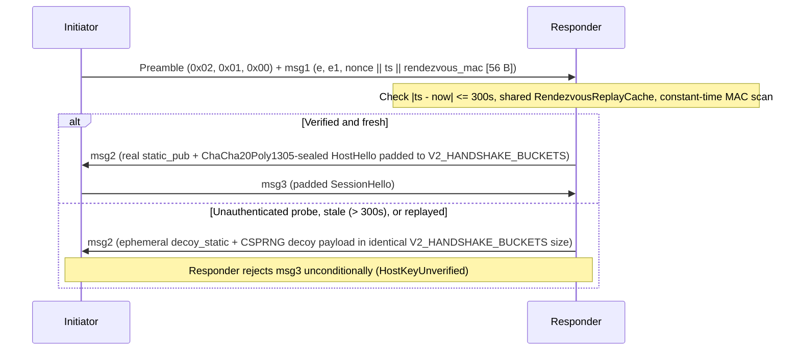

# Wire v2 privacy profile and PAKE

The Tendril v2 Privacy Profile (`WIRE_VERSION_V2 = 0x02`, specified in `spec/wire-v2.md` and `spec/relay-v2.md`) hardens handshake metadata, relay mailbox identifiers, inner frame lengths, and keepalive/rekey timing while preserving `Noise_XXhfs_25519+MLKEM768_ChaChaPoly_SHA256` and hybrid `Ed25519 + ML-DSA-65` identity signatures. Wire v1 (`0x01`) remains intact for backward compatibility with unupgraded peers.

## Preamble binding and anti-downgrade floor

Every v2 connection opens with a 6-byte cleartext preamble (`"TND" || 0x02 || intent || flags`) where `intent` is `0x01` (session) or `0x02` (pair) and `flags` is `0x00` (standard v2) or `0x01` (`FLAG_PAKE_PAIR`, permitted only when `intent == 0x02`).

- **Prologue binding:** Standard v2 connections feed the 6-byte preamble verbatim as the Noise prologue. PAKE pairing feeds `preamble (6 B) || pake_context_tag (32 B)` so mutating any preamble byte or mode flag causes AEAD failure in `msg2` and `msg3`.
- **Anti-downgrade (`min_wire_version`):** Persisted peer and pinned host records carry `min_wire_version` (`1` or `2`). Once a peer is recorded over `0x02` (or pinned with `min_wire_version = 2`), both sides persist `min_wire_version >= 2`, reject decreasing the floor without explicit revocation and re-pairing, and fail closed (`VersionDowngrade`) before disclosing `HostHello`, `SessionHello`, `PairClaim`, or burning pairing codes if `0x01` is offered. Because `PinnedHost` has no floor field and `PairingInitiator::new` / `new_m2m` default to floor `1`, initiator embedders MUST pass the persisted peer floor (via `Roster::pairing_floor` or `V2PinnedHost`) into `PairingInitiator::new_with_min_wire_version` / `PairingInitiator::new_m2m_with_min_wire_version`, or attach `PairingInitiator::with_roster_floors(&Roster)` so unpinned v1 TOFU aborts at `AwaitMsg2` with `CoreError::VersionDowngrade` (`0` `msg3` bytes written) whenever the responder already has `min_wire_version >= 2` in the roster.
- **Protocol-isolated inbound routing:** `InboundRouter` separates `0x01` and `0x02` inbound handshakes into isolated queues and rate limiters, while `set_pair_enabled(false)` disables and clears both v1 and v2 pair queues.

## Pseudonymous paired reconnect

In v1, `Noise_XXhfs` `msg2` is encrypted only under ephemeral `ee + ekem1`, allowing active scanners to read `HostHello` (`host_id`, `signing_pub`, `rotation`) and the responder's static X25519 key. In v2 session reconnect (`intent = 0x01`, `flags = 0x00`), both peers export `reconnect_secret` and `mailbox_secret` via `HKDF-SHA256` from the post-`se` chaining key and handshake hash after a completed v2 handshake.

- **Timestamped proof (`56` B):** `msg1` carries `rendezvous_nonce (16 B) || ts_be8 (8 B) || rendezvous_mac (32 B)` authenticated with `reconnect_secret` over the preamble, `e_i_pub`, and `SHA-256(e1)`.
- **Shared replay cache and constant-time scan:** Multi-connection listeners share one `RendezvousReplayCache` across concurrent inbound connections, enforcing `|ts_unix - now_unix| <= 300` seconds, evicting only expired entries at capacity, and failing closed to the decoy path when full. The responder evaluates `rendezvous_mac` across all roster entries without early exit regardless of payload length.
- **Rotation-matched decoy `msg2`:** Both genuine sealed `HostHello` envelopes and unauthenticated CSPRNG decoy payloads pad to the same `V2_HANDSHAKE_BUCKETS` (`[4096, 16384, 32768, 63488]`) size computed for the responder's real `HostHello` (including any `RotationRecord` chain), hiding `static_pub`, `host_id`, `signing_pub`, and rotation state from active scanners.
- **Post-establish floor and secret retention:** Pairing-derived `reconnect_secret` and `mailbox_secret` are retained across reconnects to prevent `msg3`-drop or concurrent-session secret desynchronization (session-exported secrets are informational/explicit-only). Reaching `Established` (`msg3` verified against an `Active` peer) raises `min_wire_version = 2`, never speculatively at `msg2`.

## Sealed refusal for revoked and pending peers

A host can tell a known device that it is revoked or still pending without telling anyone else (`spec/wire-v2.md` Sections 3.1.3 to 3.1.5). In place of the sealed `HostHello`, `msg2` carries a refusal sealed under `refusal_seal_key = HKDF-SHA256(reconnect_secret, rendezvous_nonce, "tendril-v2-refusal-seal")` with `aad = h_pre`, padded to the same bucket, over a Noise handshake that uses the decoy static key. The device fails at `msg2` with `PeerRefused` and never writes `msg3`.

- **Classification:** every roster entry gets a class on every `msg1` (`Genuine`, `Refusal(4001)`, `Refusal(4004)`, `Silent`), and CRL checks run for every entry, not only after a match. A secret that verifies for both a revoked and a non-revoked entry gives `Silent`; other matches merge in the strict order `Silent > Refusal(4001) > Genuine > Refusal(4004)`, so roster order never decides. Manifest-pinned siblings and group rendezvous secrets never refuse.
- **Revoked peers keep one secret:** a revocation that records a notice keeps only the peer's `reconnect_secret`, for the notice lifetime (30 days by default), and zeroizes `mailbox_secret`. Fork revocations never record one.
- **Separate replay cache:** refusals use their own `256`-entry replay cache and a limiter of one refusal per peer per `10 s`, in the order check, then limiter, then insert. A revoked peer flooding `msg1` cannot fill the shared cache that `Active` peers depend on, and a replay never charges the limiter.
- **Decoy timing parity:** after a refusal the host waits for `msg3` or the handshake timeout and holds the half-open slot, exactly as on a decoy. Closing early would let a passive observer on a slow path tell a refusal from a decoy.
- **Late state change:** an entry revoked between `msg1` and `msg3` gets a `0x07 CLOSE` refusal sealed under the session padding policy, which the device sees after `Established`.

| Observer | Learns from a refusal |
|---|---|
| Stranger or active scanner | nothing: a refusal looks like a decoy without the pair secret |
| Passive observer | nothing: same bucket, same timing as a decoy |
| On-path attacker | can drop it; cannot forge or replay it |
| The revoked device | that this host revoked it, and that the host at this address is the one that did. This is the main privacy cost, bounded by the notice lifetime, by `notify: false` on a revoke, and by group listeners never refusing |
| A device probing a group endpoint | nothing: group listeners never refuse, so a refusal cannot link a group endpoint to its host |

An initiator built before refusals fails the hello open and reports `HostKeyUnverified`, as on a decoy.

## Opt-in PAKE pairing (`FLAG_PAKE_PAIR = 0x01`)

For human-mediated pairing over untrusted paths, `intent = 0x02, flags = 0x01` derives `master_pake` from the normalized pairing code and a 16-byte CSPRNG `channel_salt` via `Argon2id` (`m = 19456` KiB, `t = 2`, `p = 1`, enforced minimum in production builds), then expands `pake_prologue_key`, `pake_init_key`, `pake_hello_key`, `pake_confirm_key`, and `pake_context_tag` via `HKDF-SHA256`.

- **Replay-protected `msg1`, live code cap, and Argon2id pass floor:** `msg1` carries `channel_salt (16 B) || init_mac (32 B)`. The responder checks a bounded `(channel_salt, init_mac)` replay cache before accepting, caps live pairing codes at `MAX_LIVE_PAIRING_CODES = 4` (`CoreError::ProtocolViolation` when `>= 4` unexpired codes exist), and enforces a constant-time `V2_PAKE_FIXED_ARGON2_PASSES = 4` Argon2id pass envelope on every `msg1` (`passes_run < 4` is padded with dummy Argon2id passes). Unmatched, replayed, or full-cache `msg1` attempts route to an ephemeral `decoy_static` + decoy prologue `msg2` of identical `V2_HANDSHAKE_BUCKETS` length (including the `32`-byte `resp_confirm_mac` overhead) without charging or burning live pairing codes.
- **Authenticated `HostHello`, bucketed `msg3`, and bucketed `PairResponse`:** On a valid match, `msg2` seals `HostHello` with `pake_hello_key` (AAD = `h_pre`) and appends `resp_confirm_mac`. Both `msg3` (`PairClaim`) and `PairResponse` (`Success` and `Error`) are padded to `V2_HANDSHAKE_BUCKETS` (`[4096, 16384, 32768, 63488]`) so device name/kind lengths and accept/reject verdicts do not leak on the wire. Invalid `msg3` (`init_confirm_mac` mismatch) fails with `PairingAuthFailed` without burning live codes, preventing code-burn DoS.
- **Passive dictionary work factor:** A passive observer capturing a legitimate `msg1 + msg2` exchange can test code guesses offline at one `Argon2id(19 MiB, t=2, p=1)` evaluation per guess. `Remote3Group` (`31^12 ~= 2^59.4`) resists offline brute force; shorter `Lan2Group` (`31^8 ~= 2^39.6`) codes MUST remain restricted to trusted local networks. Runtime embedders MUST bound concurrent `Argon2id` derivations.
- **Initiator derivation bound and permit wait:** The runtime holds every initiator `Argon2id` derivation under one process-wide permit pool (`DEFAULT_INITIATOR_ARGON2_PERMITS = 2`, set once with `set_initiator_argon2_permits`; the first call or first derivation wins). A pairing rung over a URI's hints takes a permit before it dials, so a rung never reveals `init_mac` and then waits. Each rung has a budget of `2 s` for `local`, `direct` and `overlay` and `4 s` for `p2p`, `relay` and `broker` (`V2_RUNG_BUDGET_NEAR`, `V2_RUNG_BUDGET_FAR`). The permit wait has its own budget of that length and never counts as derivation or dial time. A wait that runs out fails the rung with the timeout error `argon2id permit wait timed out`. That failure is uncommitted: the next rung is tried, and the attempt ends only when none is left. The explicit-endpoint initiator waits the same way within its handshake timeout. A dropped future that was queued for a permit takes nothing, and a derivation that panics releases its permit and its active count.

## Blinded hourly `/v2/relay` mailboxes

`spec/relay-v2.md` replaces `/v1/relay`'s static `device_id` with hourly (`3600` s) HKDF-derived Ed25519 `mailbox_id` keys derived from `mailbox_secret` and `uint64_be(epoch)`:

| Artifact | Derivation (`HKDF-SHA256`) | Purpose |
|---|---|---|
| `mailbox_id` | Ed25519 keypair from `info = "tendril-relay-v2-ed25519"` | Ephemeral per-epoch listener registration and `accept` signature |
| `dial_auth_key` | Key from `info = "tendril-relay-v2-dial-auth"` | Computes `conn_id`-bound `dial_token` HMAC for `dial` and `incoming` verification |

- **Host-bound challenges (`VerifiedRelayHost`):** Clients canonicalize `challenge.host` via `canonical_relay_host` (lowercase, IPv6-normalized, no trailing dot or `:port`, while preserving raw host strings for v1 HMAC compatibility) and verify it matches the dialed relay host before signing `register`, `dial`, or `accept` proofs.
- **Tier 3 unlinkability tradeoff:** Multi-epoch wildcard `RelayTicket`s (`RelayTicket::spans_multiple_v2_epochs()`) expose the same `(issuer_pub, not_before, not_after, sig)` across epochs. Deployments requiring cross-epoch unlinkability MUST use Tier 2 HMAC admission or single-epoch scoped tickets (`mint_v2_epoch_relay_ticket`, matching the single hourly epoch window with no multi-epoch overlap).
- **Atomic `incoming` verification and standby pool isolation:** `tendril serve` (`sync_v2_relay_listeners` in `tendril-cli`) binds `/v2/relay` mailboxes only for `PeerState::Active` peers with staggered multi-peer bind jitter, while `RelayV2Listener` handles single-mailbox control sockets plus a replenished `STANDBY_POOL_SIZE = 2` standby acceptor pool on the current center epoch (never shared across epochs), with CSPRNG-jittered reconnect backoffs and control pings (`22.5s..=37.5s`). Both control and standby sockets verify `dial_token` across the active `RelayEpochWindow` (`+-1` hour skew) before recording `(epoch, dial_nonce, conn_id)` in `RelayDialReplayCache` (before permit acquisition or 0-RTT `init_frame` delivery) and ignore or close invalid or replayed notifications without touching the upper session driver.
- **Per-epoch socket isolation:** Clients requiring cross-epoch unlinkability MUST open a separate control WebSocket per epoch `mailbox_id` rather than registering `(epoch - 1, epoch, epoch + 1)` on one persistent control socket.

## Group frames and bootstrap on Wire v2

Group frames `0x0A` and `0x0B` travel inside `0x09 PADDED` on Wire v2. The legacy unpadded receive path accepts only `0x01..=0x07`, so a v2 session with padding disabled cannot send or receive them. A first sibling link in a group with `min_wire_version >= 2` cannot use a stored pairwise reconnect secret, so it is admitted under a `pair_bootstrap` derived by HKDF-SHA256 from the group rendezvous key, the manifest `seq`, and both device ids. After `Established` both ends overwrite the stored pairwise secret with the session's exported secrets (the pairwise upgrade), and later dials use it; the bootstrap rotates on every revocation. A member that holds the manifest but not the current-`seq` key cannot derive the bootstrap, so an admin delivers `0x0A` and `0x0B` over its ordinary paired session first. See [Small peer mesh groups](groups.md) and `spec/groups-v1.md`.

## Bucketed inner frames and jittered scheduling

| Mechanism | Specification (`spec/wire-v2.md`) | Privacy effect |
|---|---|---|
| `0x09 PADDED` | Wraps `0x01..=0x07` inner frames (`inner_type \|\| uint16_be(len) \|\| payload \|\| 0x00...`) padded to `[256, 512, 1024, 2048, 4096, 8192, 16384, 32768, 65503]` | Hides inner frame type boundaries and exact payload sizes; constant-time zero-padding check |
| `0x08 PADDING` | Zero-filled cover frame silently discarded after AEAD decrypt and nonce advance | Supports cover traffic on v2 sessions (rejected on v1) |
| Keepalive & `REKEY` jitter | `ScheduleJitterPolicy` samples `PING` intervals (`+-25%` default) and per-epoch `REKEY` thresholds (`75%..=100%` of max frames/age) via CSPRNG | Removes periodic beacon and fixed rekey timing fingerprints |
