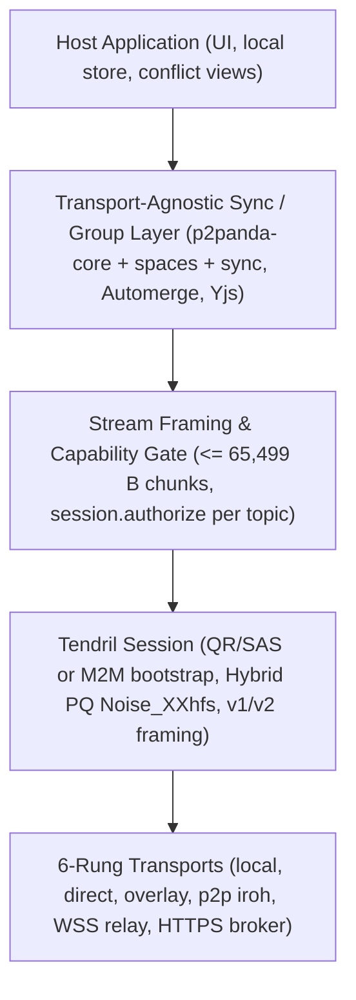

# Layering CRDT, sync, and group engines

Tendril owns pairwise trust bootstrap, hybrid post-quantum sessions, default-deny capability checks, and six-rung network failover, while leaving multi-writer conflict resolution and multi-party group state to higher layers (see [What Tendril is](../overview.md)). Transport-agnostic libraries such as [p2panda](https://p2panda.org/)[^p2panda], [Automerge](https://automerge.org/)[^automerge], and [Yjs](https://yjs.dev/)[^yjs] compose directly on top of Tendril `DATA` streams when wired along four boundaries.



## 1. Keep one transport stack in the process

Several local-first ecosystems ship both data/encryption crates and an opinionated networking crate (often wrapping `iroh` or WebSockets). Running a second P2P stack alongside [Tendril's six-rung provider ladder](../design/providers-and-relay-ladder.md) binds duplicate UDP/QUIC sockets, splits NAT-traversal budgets, and bypasses Tendril's pre-authentication rate limiters and capability gates.

| Ecosystem | Include Above Tendril | Omit (Replaced by Tendril Runtime / Web SDK) |
|---|---|---|
| `p2panda` | `p2panda-core`, `p2panda-store`, `p2panda-sync`, `p2panda-auth`, `p2panda-encryption`, `p2panda-spaces` | `p2panda-net` (Tendril already provides `iroh` P2P, browser WSS relays, Tailscale overlays, and local sockets) |
| `Automerge` | `automerge` core document and `sync::State` message generator (`generate_sync_message` / `receive_sync_message`) | `automerge-repo` WebSocket or raw TCP network adapters when Tendril owns the link |
| `Yjs` / `yrs` | `yrs` / `yjs` state vectors, `y-sync` awareness and update encoders | `y-websocket`, `y-webrtc` |

## 2. Frame or chunk sync messages within `DATA` limits

Tendril `DATA` (`0x01`) frames are discrete, AEAD-authenticated records rather than an unbounded byte stream, and oversized writes fail closed before mutating cipher state or advancing nonces. Because [the wire v2 privacy profile](../design/wire-v2-privacy.md) wraps inner frames inside a 4-byte `PADDED` (`0x09`) header (`0x09 || inner_type || uint16_be real_len`), the maximum single-frame application payload differs by 3 bytes between wire v1 and wire v2:

| Wire Profile | Outer Frame Max | Max Inner Plaintext | Max `DATA` Payload per Call | Safe Cross-Version Chunk Size |
|---|---|---|---|---|
| Wire v1 (`0x01`) | `65,519 B` | `65,503 B` | `65,502 B` | `<= 65,499 B` (e.g. `32,768 B` or `65,490 B` + header) |
| Wire v2 (`0x02`, `PADDED`) | `65,519 B` | `65,503 B` | `65,499 B` (`65,503 - 4`) | `<= 65,499 B` (fits single `65,503 B` bucket) |

CRDT snapshots, off-chain attachment bodies, and initial operation-log catchup batches routinely exceed `64 KiB`. Add a thin length-prefix or chunk envelope above `send_data` / `poll_event` capped at or below `65,499` bytes total per `send_data` call so the same framing works identically across v1 and v2 sessions:

```python
MAX_SYNC_FRAME = 65_499          # valid on both wire v1 (65,502) and wire v2 (65,499)
CHUNK_DATA = MAX_SYNC_FRAME - 5  # 1 B flags + 4 B uint32_be total message length on first chunk
MAX_SYNC_BATCH = 16 * 1024 * 1024

def send_sync_blob(session, payload: bytes) -> None:
    total = len(payload)
    if total > MAX_SYNC_BATCH:
        raise ValueError(f"sync batch {total} exceeds {MAX_SYNC_BATCH} bytes")
    if total == 0:
        session.send_data(b"\x01\x00\x00\x00\x00")
        return
    offset = 0
    first = True
    while offset < total:
        if first:
            piece = payload[offset : offset + CHUNK_DATA]
            offset += len(piece)
            done = 0x01 if offset >= total else 0x00
            header = bytes([done]) + total.to_bytes(4, "big")
            session.send_data(header + piece)
            first = False
        else:
            piece = payload[offset : offset + (MAX_SYNC_FRAME - 1)]
            offset += len(piece)
            done = 0x01 if offset >= total else 0x00
            session.send_data(bytes([done]) + piece)
```

Enforce the same ceiling on `total` (`MAX_SYNC_BATCH`) before allocating the reassembly buffer on the receiving side so a revoked or buggy peer cannot exhaust host memory mid-stream. Because `Session.send_data` releases the lock/GIL between frames and continuation chunks above carry no stream identifier, serialize `send_sync_blob` calls when multiple application tasks share one `Session` (or prepend a stream ID to each chunk).

## 3. Gate replication directions with Tendril capabilities

Group ACL systems such as `p2panda-auth` verify who *authored* a log entry or group mutation across asynchronous replicas, whereas [Tendril capability grants](../design/grants.md) decide whether the **currently connected peer** is allowed to pull or push bytes on this live session right now.

Use both layers for their strengths:

| Replication Action | Recommended Tendril Capability | Enforcement Point |
|---|---|---|
| Subscribe / pull changes from a space | `sync.pull:<space_id>` (or hierarchical `/spaces/<org>/*` via `authorize_path`) | Check `session.authorize(...)` before streaming local log heads or CRDT state vectors to the peer |
| Push new operations or CRDT deltas | `sync.push:<space_id>` | Check `session.authorize(...)` before feeding incoming sync bytes into the CRDT or `p2panda` ingestion pipeline |
| Fetch content-addressed blobs | `blob.read:<space_id>` | Gate large attachment reads independently from lightweight metadata sync |
| Invite a temporary collaborator | `pair.mint` + subset `sync.pull:<space_id>` | Delegate a read-only, time-bounded pull grant up to 4 hops offline without modifying group root membership |

Note that `session.authorize` matches opaque ASCII strings; whenever you scope grants to `/` path prefixes such as `/spaces/<org>/*` instead of flat `<space_id>` identifiers, call `authorize_path` in Rust or canonicalize paths per `spec/grants-v1.md` Section 1.2 before calling `session.authorize` in host bindings so `..` segments and sibling prefixes fail closed. Evaluating capabilities before passing wire bytes into a CRDT or log parser rejects expired devices and revoked grant nonces at the session boundary (returning a structured `AuditEvent` in Rust/WASM or a boolean allow/deny result across FFI/Python/Node bindings) before complex deserialization runs.

## 4. Keep cryptographic and metadata boundaries explicit

> [!IMPORTANT]
> **Outer post-quantum links do not make inner classical group keys post-quantum.**
> Tendril protects every pairwise link with `Noise_XXhfs_25519+MLKEM768_ChaChaPoly_SHA256` and hybrid `Ed25519 + ML-DSA-65` grants, preventing a passive network observer who records relay or Wi-Fi traffic today from decrypting the sync stream later. Libraries such as `p2panda-spaces` and `p2panda-core` currently sign operations with classical `Ed25519` and derive multi-party group keys with classical `X25519` ratchets/DCGKA. Once decrypted at an intermediate replica, group ciphertext stored on disk or re-shared with another group member relies on that inner classical suite.

Keep three operational rules in mind when combining the two models:

1. **Bootstrap invites over Tendril first.** Use Tendril's QR `sh=` hash-pinned pairing, 16-character SAS check, or M2M Trust Anchor enrollment to establish an authenticated pairwise link before exchanging `p2panda` space invite bundles or initial CRDT documents, eliminating out-of-band key-exchange guesswork.
2. **Enable wire v2 when syncing chatty CRDT awareness.** Keystroke-level CRDT updates and cursor-awareness beacons emit small, frequent frames whose sizes and intervals leak activity patterns on wire v1. Running over [wire v2](../design/wire-v2-privacy.md) rounds inner frames to fixed size buckets (`256 B` to `32,768 B` powers of two plus `65,503 B`) and jitters background keepalives and `REKEY` ratchets.
3. **Treat revocation at both layers.** Revoking a stolen laptop in Tendril (`tendril revoke <peer_id>`) immediately causes your hosts to terminate active sessions and reject future handshakes across direct and relayed paths (rotate managed relay admission tickets separately if you also want edge drops at a private relay), while removing that member inside `p2panda-spaces` rotates the shared group encryption secret so other replicas in a mesh stop encrypting future group entries to it.

[^p2panda]: p2panda modular local-first crates
[^automerge]: Automerge CRDT library
[^yjs]: Yjs shared data types
