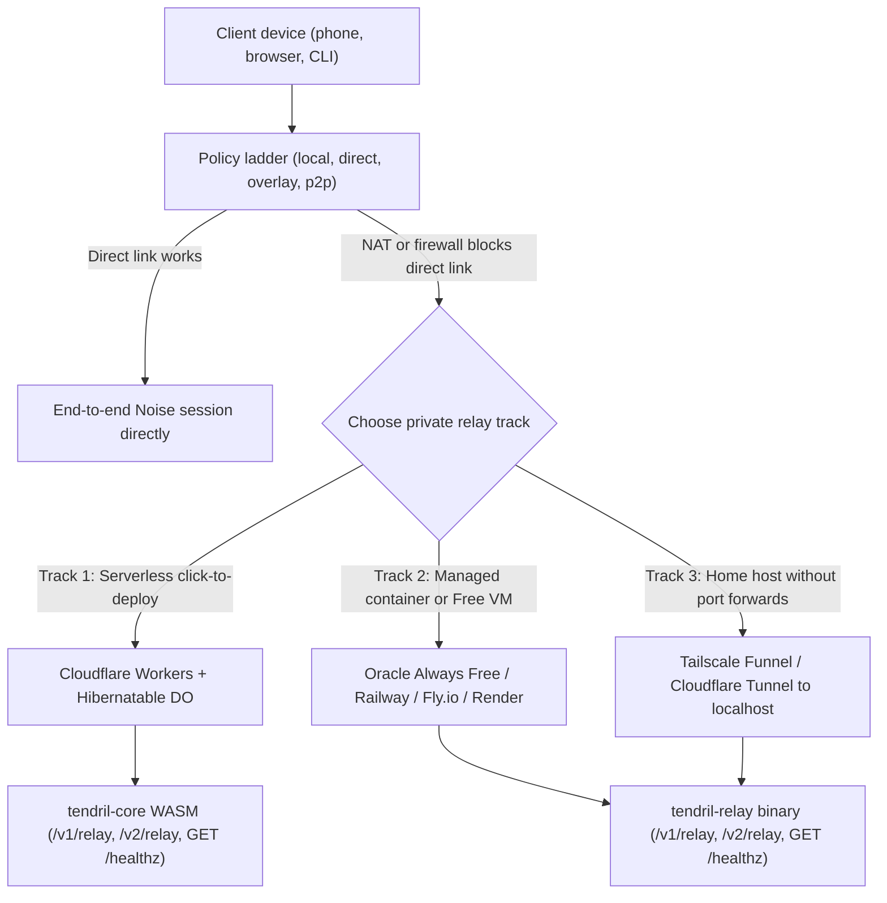

# Private relay hosting and deployment

A Tendril relay forwards Noise ciphertexts over WebSockets on `/v1/relay` and `/v2/relay` when two devices cannot reach each other over LAN, a Tailscale overlay, or peer-to-peer UDP. Because every session is end-to-end encrypted inside `tendril-core` (`Noise_XXhfs_25519+MLKEM768_ChaChaPoly_SHA256`), the relay operator cannot read messages or forge capability grants.

Hosting your own relay keeps traffic off shared infrastructure, isolates rate limits for your devices, and gives Day-2 reconnects a stable fallback address. Pick one of the three tracks below depending on whether you want one-click serverless hosting (no container maintenance), a managed single container / Always Free VM, or a local binary behind a tunnel.



## Pick a hosting track

Tendril tries `local`, `direct`, `overlay`, and `p2p` (`iroh`) links before falling back to `relay`, so relay bandwidth stays low unless devices sit behind strict firewalls or connect from web browsers.

| Option | Audience | Cost and Allowance | Persistent Listeners | Config Location |
|---|---|---|---|---|
| **Cloudflare Workers + DO** | Developers and app end users | Free tier (`100k` req/day, `20:1` WS frame billing ratio) | Yes via WebSocket Hibernation | [Cloudflare Worker template](https://github.com/agync/tendril/tree/main/deploy/cloudflare) |
| **Tailscale Funnel + Host** | App end users | Free with Tailscale account (bandwidth limits apply) | While host device stays awake | See [Track 3: Tailscale Funnel or Cloudflare Tunnel](#track-3-tailscale-funnel-or-cloudflare-tunnel) |
| **Oracle Cloud Always Free** | Developers and self-hosters | Always Free E2.1.Micro (card required for signup verification) | Yes | [Oracle Cloud stack](https://github.com/agync/tendril/tree/main/deploy/oracle) |
| **Render Blueprint (`free`)** | Testing and wake-assisted peers | Free web service, sleeps after 15 min idle | Sleeps on `free` (paid `starter` stays up) | [Render Blueprint](https://github.com/agync/tendril/tree/main/deploy/render) |
| **Railway Docker image** | Developers and small teams | Usage trial then Hobby credit tier, bills active CPU and RAM | Yes while credit covers runtime | [Railway config](https://github.com/agync/tendril/tree/main/deploy/railway) |
| **Fly.io (`--ha=false`)** | Developers wanting regional placement | Free plan: $5/mo credit with card ($1 for 7 days without card; over $5 bills full month) | Yes with `min_machines_running = 1` | [Fly.io config](https://github.com/agync/tendril/tree/main/deploy/fly) |

> [!IMPORTANT]
> Run `tendril-relay` as a single instance (`numReplicas: 1`, `numInstances: 1`, or `fly launch --ha=false`), and keep the Cloudflare Worker routed to one named Durable Object (`global`). Registered mailboxes live in single-instance memory or attached sockets, so load-balancing across two replicas causes dials to fail `"offline"`.

## Track 1: Cloudflare Workers and Durable Objects

`deploy/cloudflare/` packages a thin Cloudflare Worker router and a singleton SQLite-backed Durable Object (`TendrilRelay`) powered by `tendril-core` compiled to WebAssembly. App end users with a GitHub and free Cloudflare account can deploy a private personal relay directly from their browser without running containers or managing Linux hosts, and app developers can embed the same button in onboarding docs or deploy the worker into their own organization account.

<p><a href="https://deploy.workers.cloudflare.com/?url=https://github.com/agync/tendril/tree/main/deploy/cloudflare"></a></p>

1. Click **Deploy to Cloudflare** (no credit card is required on Cloudflare Workers Free for a forked repo deployment), sign in, authorize GitHub fork creation, and let Workers Builds compile `tendril-wasm` into the Worker bundle via `scripts/build.sh` (`main` branch by default, configurable via `TENDRIL_SOURCE_REF`).
2. Open the deployed Worker's **Settings -> Variables and Secrets** and add `TENDRIL_RELAY_AUTH_SECRET` (generate a `32`-byte secret via `openssl rand -hex 32`) so unauthenticated callers on your `*.workers.dev` URL cannot probe mailboxes or consume quota.
3. For scripted or developer deployments from a local checkout:

```bash
cd deploy/cloudflare
npm ci
npx wrangler secret put TENDRIL_RELAY_AUTH_SECRET
npx wrangler deploy
```

### Cloudflare Free-plan envelope and design rules

`deploy/cloudflare/wrangler.jsonc` declares `new_sqlite_classes: ["TendrilRelay"]`, which satisfies Cloudflare Free's requirement that Durable Objects use SQLite storage. Quiet registered `/v1/relay`, `/v2/relay`, and `standby` control sockets hibernate with zero wall-clock duration billing until a frame arrives, and Durable Object alarms never close quiet listeners at the `300 s` stream-idle ceiling. Incoming WebSocket frames count against the Free `100,000` requests/day cap at a `20:1` ratio, and Tendril only uses the relay when `local`, `direct`, `overlay`, and `p2p` links cannot connect.

Set `TENDRIL_RELAY_AUTH_SECRET` for Tier 2 HMAC, `TENDRIL_RELAY_ISSUER_PUBS` for Tier 3 signed `RelayTicket` issuers (comma-separated base64url Ed25519 keys), `TENDRIL_RELAY_ALLOW_MAILBOXES` for Tier 1 allowlisted keys, and `TENDRIL_RELAY_AUTH_SCOPE` (`"all"` or `"register-only"`; the default is `"register-only"` when only `TENDRIL_RELAY_ALLOW_MAILBOXES` is set and `"all"` otherwise, and `"all"` with only an allowlist fails closed). On `dial`, `TendrilRelay` verifies admission inside `tendril-core` WASM before decoding `init_frame`, checking epoch skew, or looking up mailboxes so unauthenticated callers cannot probe peer presence.

Socket attachments stay under `1 KiB` across hibernations. Classic non-`fast_open` `init_frame` payloads up to `65,521` bytes live transiently in Durable Object SQLite (`pending_init_frames`) until claimed, withdrawn, or timed out. When serving behind a custom domain whose internal request hostname differs from what clients expect in `challenge.host`, set `TENDRIL_RELAY_HOST` in Wrangler variables.

## Track 2: PaaS container deployment

The official OCI image (`ghcr.io/agync/tendril-relay:latest`, built from the root `Containerfile`) reads standard PaaS environment variables with no shell wrapper or start-command override.

1. `Containerfile` sets `ENV PORT=8443`, so standalone Docker or Podman runs bind `0.0.0.0:8443` and platforms injecting `PORT` override the port on `0.0.0.0:$PORT`.
2. When `--host` is absent, startup checks `TENDRIL_RELAY_HOST`, `RAILWAY_PUBLIC_DOMAIN`, `RENDER_EXTERNAL_HOSTNAME`, `KOYEB_PUBLIC_DOMAIN`, and `<FLY_APP_NAME>.fly.dev` in that order before defaulting to `localhost`.
3. Every resolved host is canonicalized and checked with `canonical_relay_host` at startup, rejecting schemes, ports, paths, and whitespace.
4. Plain HTTP `GET /healthz` and `HEAD /healthz` probes (with no `Upgrade` or `Sec-WebSocket-Key` header) return `200 OK` (`ok`), while WebSocket upgrades to `/healthz` return `404 Not Found`.

### Configuration precedence

The `--listen` flag takes precedence over `TENDRIL_RELAY_LISTEN` (`ip:port`), which takes precedence over `PORT` (`0.0.0.0:<PORT>`), falling back to `127.0.0.1:8443`. Empty `PORT` values are ignored so shell wrappers with unset variables still start cleanly, while explicit `TENDRIL_RELAY_LISTEN` or invalid port numbers fail closed at startup.

### Render Blueprint

`deploy/render/render.yaml` declares a single-instance web service (`numInstances: 1`) running `ghcr.io/agync/tendril-relay:latest` with a generated `TENDRIL_RELAY_AUTH_SECRET` and `/healthz` checks.

Render Free spins down after 15 minutes with no inbound traffic and drops open `/v1/relay` and `/v2/relay` control sockets. Pair Render Free with LAN/P2P routes or out-of-band [Opaque wake providers](../design/wake-providers.md), or switch `plan: free` to `plan: starter` for always-on listeners.

### Fly.io single-machine setup

Use `deploy/fly/fly.toml` with `--ha=false` so Fly creates one machine instead of two regional replicas:

```bash
fly launch --copy-config --ha=false --no-deploy
fly secrets set TENDRIL_RELAY_AUTH_SECRET="$(openssl rand -hex 32)"
fly deploy --ha=false
```

`tendril-relay` detects `FLY_APP_NAME` automatically and binds challenge nonces to `<app>.fly.dev`. One `shared-cpu-1x` (`256 MB`) machine (~USD 2/mo) fits within Fly.io's Free plan ($5/mo allowance once a card is added, or a $1 one-time 7-day credit without a card; exceeding $5 in a month moves the organization to Pay As You Go and bills the entire month from the first cent). Pin a release tag (`ghcr.io/agync/tendril-relay:vX.Y.Z`) matching a release that includes PaaS env support instead of `:latest` for production deployments.

### Railway container service

Point a Railway service at `ghcr.io/agync/tendril-relay:latest`, set `TENDRIL_RELAY_AUTH_SECRET`, enable a public HTTP domain, and keep `numReplicas: 1` and `healthcheckPath: "/healthz"` per `deploy/railway/railway.json`. `tendril-relay` detects `PORT` and `RAILWAY_PUBLIC_DOMAIN` automatically.

## Oracle Cloud Always Free stack

`deploy/oracle/` ships an OpenTofu/Terraform stack (`VM.Standard.E2.1.Micro` by default, with an option for `VM.Standard.A1.Flex` ARM64) for OCI Resource Manager Stacks or `tofu apply`:

- Creates a VCN, subnet, and ingress security rules for ports `80` and `443`.
- Runs an unprivileged Podman container (`65532:65532`, `--read-only`, `--cap-drop=ALL`) with `ghcr.io/agync/tendril-relay:latest` on `127.0.0.1:8443` and `--trusted-proxy 127.0.0.1/32`.
- Writes `TENDRIL_RELAY_AUTH_SECRET` (`48` generated characters when omitted) to `/etc/tendril-relay/auth.secret` with `0600` permissions.
- Terminates HTTPS in Caddy for your domain, or `<public_ip>.sslip.io` when `relay_domain` is blank.

## Track 3: Tailscale Funnel or Cloudflare Tunnel

If you keep a home server, desktop, or NAS online, expose a loopback relay over HTTPS without router port forwards:

```bash
# Option 1: Standalone tendril-relay behind Tailscale Funnel
tendril-relay \
  --listen 127.0.0.1:8443 \
  --host "<node>.<tailnet>.ts.net" \
  --trusted-proxy 127.0.0.1/32 \
  --auth-secret-file ./relay-auth.secret

tailscale funnel --bg 8443

# Option 2: Built-in EmbeddedRelay bundled with `tendril serve`
# (`--embedded-relay` binds a random `127.0.0.1:<port>` printed in the `listening` JSON line
# without `--trusted-proxy` or admission auth; point `tailscale funnel --bg <port>` at that port)
tendril --state-dir ./host-state serve \
  --embedded-relay \
  --relay-host "<node>.<tailnet>.ts.net" \
  --advertise-endpoint "wss://<node>.<tailnet>.ts.net/v1/relay" \
  --issue-code auto
```

For Cloudflare Tunnel (`cloudflared`), route your subdomain to `http://127.0.0.1:8443` and start `tendril-relay` with `--host <your-subdomain.example> --trusted-proxy 127.0.0.1/32`. See [Stateless relay v1 and async runtime providers](../design/relay-and-runtime.md) for trusted-proxy header rules.

## Relay admission control

Always configure at least one admission rule on a public HTTPS endpoint so unauthenticated callers cannot fill mailbox tables or burn egress quota.

| Deployment Model | Recommended Mechanism | Configuration |
|---|---|---|
| Personal relay (end users) | Tier 2 shared HMAC secret | Generate a `32`-byte random secret (`openssl rand -hex 32`) into `TENDRIL_RELAY_AUTH_SECRET` or a `0600` secret file. |
| Shared or multi-tenant app relay | Tier 3 signed `RelayTicket` | Set `--issuer-pub <b64url_pub>` on the relay and mint short-lived tickets (`1..=86400 s`) with `tendril relay-ticket`. |
| Closed hardware fleet | Tier 1 mailbox allowlist | Pass `--allow-mailbox <b64url_pub>` or `--allow-mailboxes-file <path>` for fixed `/v1/relay` keys. |

With a shared secret or ticket issuer configured, the default `--auth-scope all` requires admission on `register`, `accept`, and `dial`. On `dial`, the relay checks `auth` before mailbox lookup so callers without valid credentials cannot probe whether a peer is online. With only a Tier 1 allowlist the default is `register-only`, and the relay refuses to start if `all` is set explicitly. Allowlist keys must be valid Ed25519 public keys; the relay refuses to start otherwise.

A registration admitted by a `RelayTicket` lasts until the ticket's `not_after` plus the `30 s` clock skew. At that point the relay closes the listener's control and standby sockets, so listeners need a fresh ticket to register again; streams already bridged keep running until they close.

## Host and client setup

Once your relay serves `wss://<relay_host>/v1/relay` and `wss://<relay_host>/v2/relay`, start the host listener and pair the client:

```bash
# 1. Start host with private relay and authentication secret
tendril --state-dir ./host-state serve \
  --relay "wss://<relay_host>/v1/relay" \
  --relay-auth-secret-file ./relay-auth.secret \
  --wire-v2 --relay-v2 \
  --issue-code auto

# 2. Pair a client and allow credential delivery to that origin
tendril --state-dir ./cli-state pair \
  --pairing-uri "tendril://pair?..." \
  --relay-auth-origin "wss://<relay_host>" \
  --relay-auth-secret-file ./relay-auth.secret

# 3. Confirm SAS, mint grant on host, then dial by target name
tendril --state-dir ./host-state confirm <client_device_id> --sas "<sas>"
tendril --state-dir ./host-state mint <client_device_id> --cap notes.read
tendril --state-dir ./cli-state dial \
  --target my-host \
  --relay-auth-origin "wss://<relay_host>" \
  --relay-auth-secret-file ./relay-auth.secret \
  --grant '<grant_json>' --message "hello"
```

Pass `--relay-auth-origin "wss://<relay_host>"` (or `relay_auth_origins` / `relayAuthOrigins` in language bindings) whenever the relay endpoint comes from a scanned QR code or signed route set rather than an explicit `--endpoint`. In an app offering private-relay onboarding to end users, accept any `wss://<relay_host>/v1/relay` URL pasted by the user (along with their generated secret and matching `relayAuthOrigins`), validate the origin with `relay_auth_origin_allowed`, and add `/v2/relay` on the same origin once peers pair and activate Wire v2. For wire rules and rate limits, see [Stateless relay v1 and async runtime providers](../design/relay-and-runtime.md) and [Reference CLI, relay deployment, and conformance peer](cli-demo.md).
