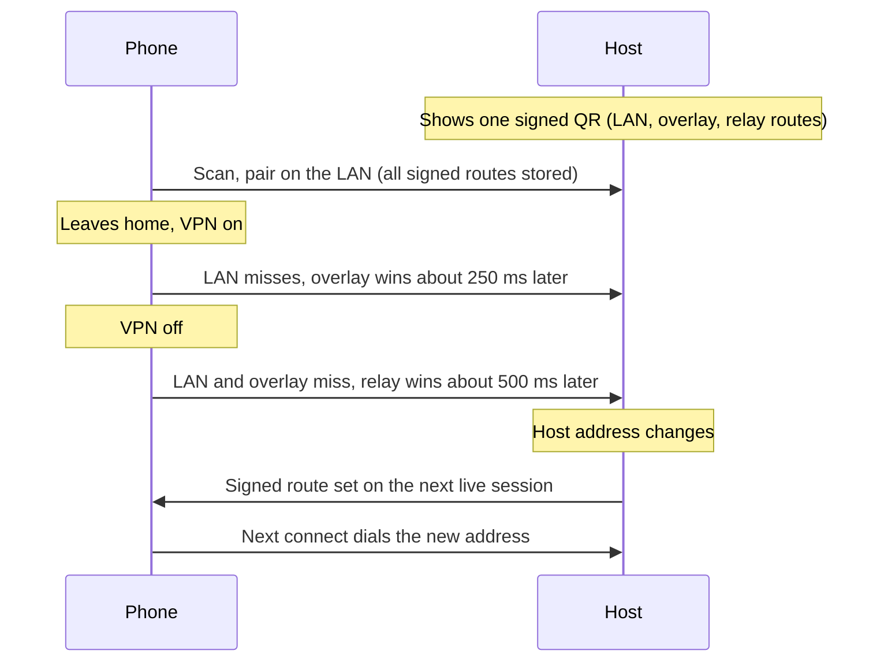

# Seamless pairing defaults

A host shows one QR code. The phone scans it and pairs. From then on the phone reaches the host on the home LAN, over a VPN overlay when away, and through a relay when neither works, with no prompt, flag or re-pair. When the host's addresses change, the host tells its paired clients.

This page describes the defaults that make that work and the switches that change them. Normative rules live in `spec/pairing-v1.md` (Section 6) and `spec/wire-v1.md` (Section 5.2). Per-language calls are listed in [FFI ABI and cross-language bindings](../reference/ffi-and-bindings.md) and, for the browser, [Web and mobile bindings](../reference/web-and-mobile.md).

## Defaults at a glance

| Setting | Default | Who sets it | Opt-out |
|---|---|---|---|
| Route advertising | LAN and overlay addresses, found automatically | SDK and FFI hosts (Go, Python, Node, Swift, Kotlin) | `advertise: "explicit"` |
| CLI advertising | Only concrete `--listen` binds, the `--relay`, `--relay-v2`, `--p2p`, `--overlay` and `--broker` endpoints and `--advertise-endpoint` values | `tendril serve` | n/a (the CLI is always explicit) |
| Host signing | Every issued URI carries `rq` and `rs` | Host | `sign_routes: false` or `serve --no-route-signature` (interop tests only) |
| Client route policy | `allSigned`: keep every route the host signed | Client | `committedOnly` or `none` |
| Route updates | Signed announcements applied silently under `allSigned` | Client and host | `committedOnly` or `none` |
| Code kind | `Remote3Group` whenever any non-LAN route is present or no route survives, else `Lan2Group` | Host | Request `lan` or `remote` explicitly |
| Relay credentials | Sent only to origins the developer configured, or to the call's explicit endpoint | Developer or operator | n/a |

The end user only scans. The developer configures relay origins once.

## What the user sees



| Moment | What happens | Prompt |
|---|---|---|
| Day 1, at home | Phone scans the QR, races the LAN, overlay and relay routes, and the LAN wins. Every signed route is stored with the pairing. | None |
| Day 2, away, VPN on | The stored LAN route misses, the overlay route wins. | None |
| Day 2, away, VPN off | LAN and overlay miss, the relay route wins. | None |
| Host address changes | The host signs a new route set and sends it to every live client. Clients apply it and the next connect uses the new address. | None |

## Ladder and timing

Day-2 connects order the stored routes by the path planner (`local`, `direct`, `overlay`, `p2p`, `relay`, `broker`, numeric hosts first). Each lower-ranked candidate starts 250 ms after the previous one, or at once when every earlier candidate has already failed. `p2p` waits at least 500 ms after the first non-p2p dial.

| Stored routes | Start times |
|---|---|
| One LAN, one overlay, one relay | LAN at 0 ms, overlay at about 250 ms, relay at about 500 ms |
| Two LAN routes, then overlay | Overlay at about 500 ms |
| LAN address refused or unreachable | The next route starts at once |

The first candidate whose handshake proves the pinned host wins and the rest are cancelled. A route that reaches the wrong device fails the pin check at the host's first reply, so a familiar private address on another network is rejected before the client reveals its own key.

## The pairing URI

A host-signed URI looks like this (line breaks added):

```text
tendril://pair?v=1&host=<name>&code=<code>&k=<host static key>&sh=<signing key hash>
  &rp=<relay key>&ep=<hint>,<hint>,...&rq=<route sequence>&rs=<route signature>
```

| Field | Meaning |
|---|---|
| `k`, `sh` | Pin the host's static key and the hash of its signing key. Checked before the client sends its own key. |
| `ep` | Up to six route hints, each at most 256 bytes. Hints say where to dial and never grant anything. |
| `rp` | The 32-byte Ed25519 key that selects the host's `/v1/relay` mailbox. Required when `ep` holds a `/v1/relay` hint and checked against the host's authenticated key before the client commits. |
| `rq` | Route sequence, a decimal number from 1 to 2^53-1. Present exactly when `rs` is. |
| `rs` | Ed25519 signature over every byte before it, made with the host's identity key. Always the last parameter. |

Rules that matter to integrators:

- Pass the exact scanned string to the parser. `rs` covers the bytes, so any normalizing, reordering or re-encoding breaks verification.
- A signed URI is about 700 bytes with six hints, inside QR Version 21 at error correction M. The hard limit is 1,024 bytes. The builder reports `uri_len` and `qr_version_m` and never drops hints to meet the soft target.
- `rs` is classical Ed25519 because a hybrid signature does not fit a QR code. A forged `rs` can influence route metadata only, never session keys. Route announcements inside a session are hybrid-signed.
- Hints from a URI never include same-machine IPC (`local:`, `unix://`), and a `/v2/relay` hint is never dialed during pairing.

## Route policies

A client keeps routes according to one setting, endpoint-wide, with a per-call override.

| Policy | Pairing a signed URI | Pairing an unsigned URI | Host announcements |
|---|---|---|---|
| `allSigned` (default) | Stores every signed route, including ones this client cannot dial | Stores nothing (`--save-route` keeps the route that carried the pairing) | Applied silently |
| `committedOnly` | Stores the route that carried the pairing as a `signed` route | Stores the route that carried the pairing as a `committed` route | Ignored |
| `none` | Stores nothing from the URI | Stores nothing | Ignored |

Every stored route records its source: `operator` (typed by you), `signed` (host-signed), or `committed` (the route that carried an opted-in unsigned pairing, through `--save-route` or `committedOnly`). A signed replacement never removes an `operator` or `committed` route, and an operator write never touches `signed` routes.

An unsigned URI persists nothing by default on purpose. Nothing authenticates the absence of a signature, so a stripped URI with a swapped relay would otherwise plant a durable relay in the roster. Hosts sign by default, so unsigned URIs come from interop hosts or tampering.

If two QR codes are live at `rq = 4` and `rq = 5`, a client that already learned 5 can still pair with the older one. The stored sequence never goes down, and the older URI's routes are not applied.

## Signed route updates

A paired host keeps its clients current with the `0x0C ROUTE_SET` frame.

| Property | Behaviour |
|---|---|
| Contents | The host's keys, a persistent sequence, an issue time, and up to six hints, signed with the hybrid Ed25519 and ML-DSA-65 identity key |
| Opt-in | A client sends `route_seq` in its session hello only under `allSigned` and only for a host that already signed a route set. Older clients never receive the frame. |
| When the host sends | Once after a session is established when its sequence is newer than the client's, and again after any change of its advertised set |
| Rate limits | Host debounces 2 s and sends at most one per 30 s per session. Client processes at most one per 10 s. |
| Client rules | Valid hybrid signature, matching pin, newer sequence (an equal sequence is also accepted when the stored route set came from a URI). Rejections are recorded and never close the session. |
| Effect | Replaces the `signed` routes only. `operator` and `committed` routes stay. |

A host republishes when a listener starts or stops, when `advertised_endpoints` or relay configuration changes, and on a 60-second timer plus a platform network callback on SDK hosts. The sequence lives in the host's roster, so it survives restarts and only moves up when the set changes.

## Revocation evidence survives route writes

A session can carry a revocation list (CRL) that revokes the host you are connected to, or this device. That evidence is never lost to a route write.

| Event | Behaviour |
|---|---|
| A route write (a route set, `setPeerRoutes`, `clearPeerRoutes`, an offline `applyRouteUri`, a pairing) | CRLs a live session accepted but has not yet persisted are merged into the roster before it is written, so the write never drops them. |
| A roster reload (a CLI tick, or loading the roster through the runtime's roster handle) | The reload keeps those in-memory CRLs. CRLs signed by an active trust anchor count, not only those signed by a paired peer. |
| A connect that fails because the list revoked the peer | The list is persisted first and the connect then fails with `PeerRevoked`. Every exit path of a session driver persists the CRLs it queued. |
| A write or store error | CRL evidence that could not be written stays queued for the next run. The route sets of that run are dropped. |
| A Day-2 connect that did not send `route_seq` | It still installs client ingest, so CRLs it receives are persisted. |

Route sets themselves are applied off the session's I/O loop, because applying one takes the roster file lock and writes files.

## Advertising on SDK hosts

With `advertise: "auto"`, a host enumerates its interfaces for every pairing-capable TCP listener bound to an unspecified address.

| Class | Advertised as | Condition |
|---|---|---|
| LAN | `direct:<ip>:<port>` | Private IPv4 or ULA address on Wi-Fi or Ethernet, or on the desktop `Other` transport |
| Overlay | `overlay://<ip>:<port>` | Address in `100.64.0.0/10` or a ULA, on a network that is a VPN or whose interface is named `tailscale*`, `wg*`, `zt*`, `utun*` or `tun*` |
| Never | n/a | Loopback, link-local, public, and any address on a cellular-only network |

An address that falls in the carrier-grade NAT range is not treated as an overlay without VPN evidence. A public address is advertised only when you bind a listener to it or list it in `advertised_endpoints`.

Android hosts pass a complete network snapshot to `refreshRoutes`, and Swift hosts call `refreshRoutes()` from a path monitor. A snapshot with no networks is held for 30 seconds before the host retires the addresses.

> [!NOTE]
> A QR code is a picture. Anyone who photographs it learns the advertised addresses and the relay key until its single-use code expires. Apps that must not reveal local addresses set `advertise: "explicit"`.

## Relay credential origins

A relay ticket or shared-secret proof is a bearer credential. Tendril sends it only to an origin you listed, or to the explicit endpoint of the call.

| Surface | Setting |
|---|---|
| CLI | `--relay-auth-origin <scheme://host:port>` (repeatable) on `pair` and `dial` |
| C ABI, Go, Swift, Kotlin | `relay_auth_origins` in `tendril_endpoint_configure_transports_json` |
| Python, Node | `relay_auth_origins` in `configure_transports_json` (Node: `configureTransportsJson`) |
| Browser | `relayAuthOrigins` next to `relayAuthTicket` and `relayAuthSecret` |

Matching is byte-equal on scheme, host and port, with default ports made explicit. A relay learned only from a URI, a stored `signed` or `committed` route or an announcement never receives credentials. If it demands them, that candidate fails with `relay_auth_unconfigured` and the race continues.

## Connecting without an endpoint

`connect` and `connectV2` take an optional endpoint on every surface.

| Call | Behaviour |
|---|---|
| No endpoint | Dials the peer's stored routes, ordered by the ladder. Legacy `relay_hints` are never dialed. |
| An endpoint | Dials that one operator endpoint alone, after normalization. |
| A recovery URI | Adds a fresh URI's signed hints and checks its keys before the client commits. |

If the roster holds no dialable route, the error names the skipped routes and both ways out: a fresh signed QR, or an explicit endpoint. Failure text shows every route as `scheme://host[:port]` or `<redacted>`, never the credentials, tokens or codes a hint can carry.

A connect with an explicit endpoint, Wire v2 and a configured wake target can also wake a sleeping peer first. That connect runs these same rules (route sequence, route sets, recovery URI); see [Opaque wake providers](../design/wake-providers.md#wake-around-a-connect).

## Recovery by a fresh QR

Stored routes can all go dead, for example when the host moves networks while the client is offline. The client cannot learn new routes from a host it cannot reach.

| Situation | What to do |
|---|---|
| A relay is among the host's advertised routes | Nothing. The relay is a stable anchor, and announcements bring the other routes up to date on the next connect. |
| No relay, host moved | Scan a fresh signed QR. Apply it offline with `tendril route apply`, `applyRouteUri` or `apply_route_uri`, or pass it as a recovery URI to `dial`. |
| Host rotated its keys | Pass the fresh URI as a recovery URI while any stored route still reaches the host. The client verifies the rotation chain and then the route signature, and only then stores the routes. |

A URI whose `rq` is newer than the stored sequence replaces the `signed` routes automatically under `allSigned`. An equal or older one is used for that dial only, and replaces the stored routes only with explicit approval (`--replace-routes`, `replaceRoutes`, `replace_routes`). An approved replacement holds until the host publishes a strictly newer set.

## Route commands in the CLI

```bash
# Inspect a peer's routes, their source and the last announcement outcome
tendril --state-dir ./cli-state route list --target my-host

# Replace the operator routes, remove them, or clear every source
tendril --state-dir ./cli-state route set --target my-host --endpoint 192.168.1.20:7000 --endpoint wss://relay.example/v1/relay
tendril --state-dir ./cli-state route clear --target my-host --source all

# Apply a fresh host-signed URI offline
tendril --state-dir ./cli-state route apply --pairing-uri "tendril://pair?..." --route-policy all-signed
```

See [Reference CLI, relay deployment, and conformance peer](cli-demo.md) for every flag.

## Upgrading from earlier versions

`tendril pair --pairing-uri` used to save every hint of the URI into the roster as `relay_hints` and never dialed them later. Hosts now sign their URIs, and `pair` saves every route of a URI whose signature verifies as host-signed routes, which `dial` uses without `--endpoint` and which the host keeps current.

- A URI without a valid host signature saves no route by default. `--save-route` saves only the route that carried the pairing, and `--endpoint` saves that endpoint.
- Hints saved by earlier versions stay in `relay_hints` as display data and are not migrated into dialable routes. Re-pair with a fresh URI, apply one with `tendril route apply`, or pass `--endpoint`.
- `tendril pair --relay-v2` is removed. Pair over another route, then use `dial --relay-v2`.
- Iroh pairing hints no longer use Pkarr or DNS lookup.
- SDK hosts advertise LAN and overlay addresses by default.
- A host built before this feature rejects a session hello that carries `route_seq`. Only a client that holds a signed route set from that host sends it. A client facing a downgraded host connects with `committedOnly`.
